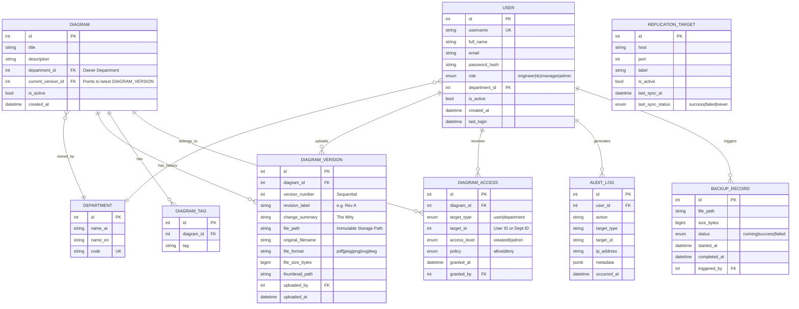
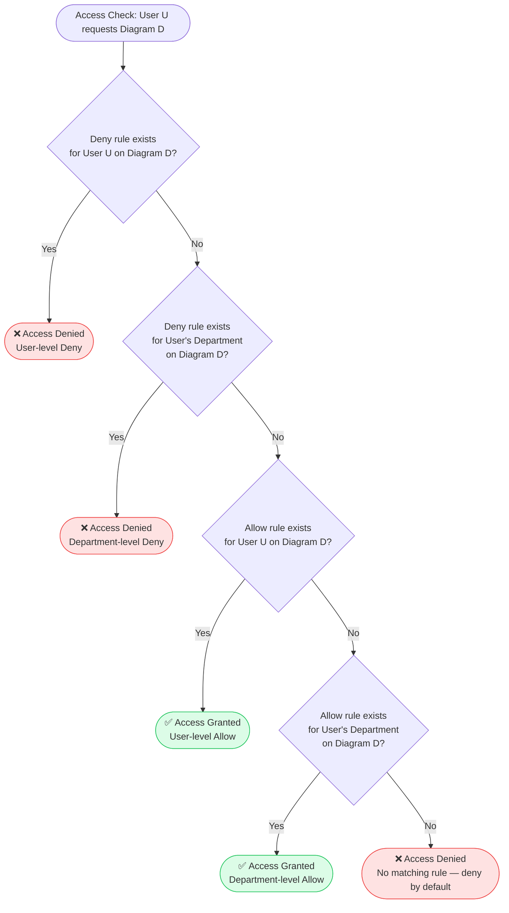
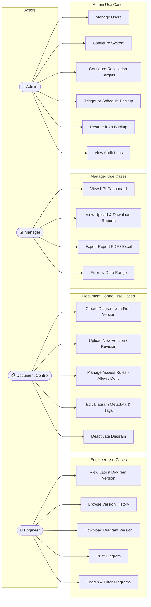
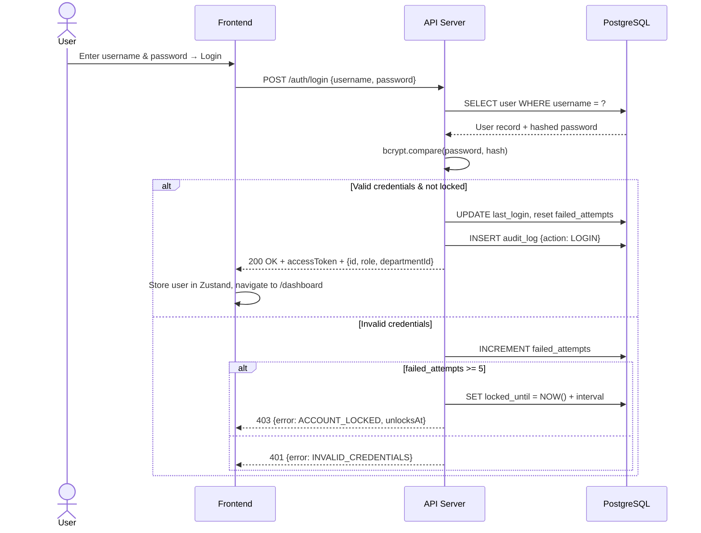
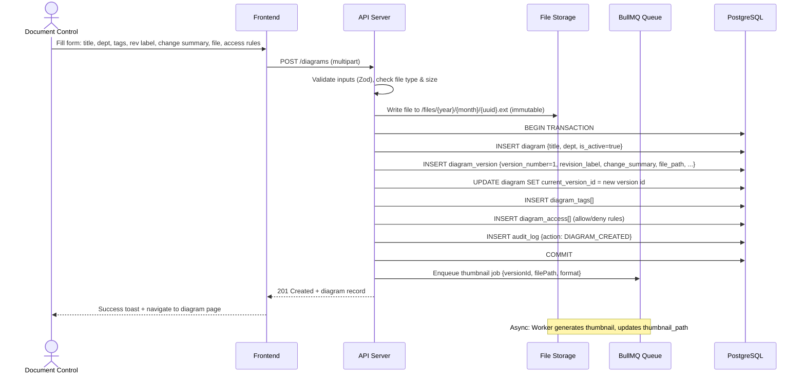
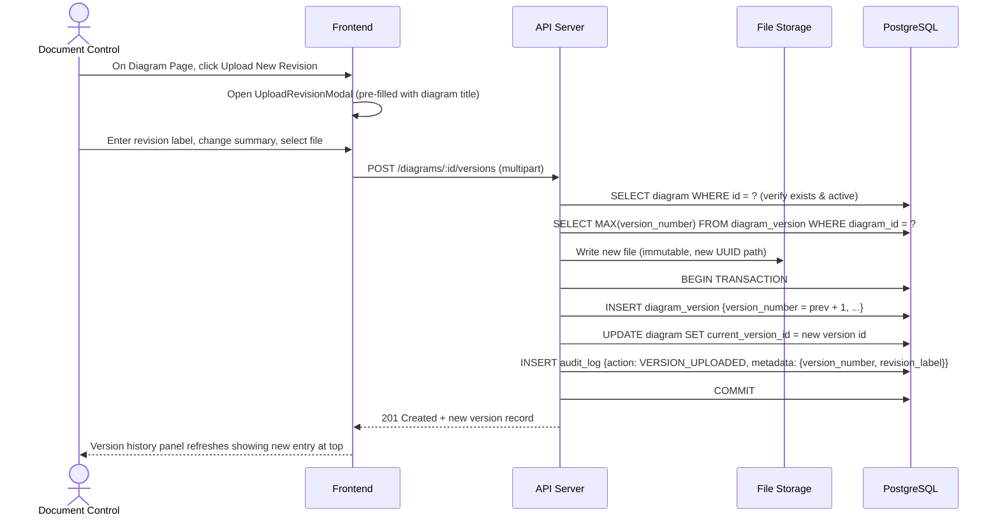
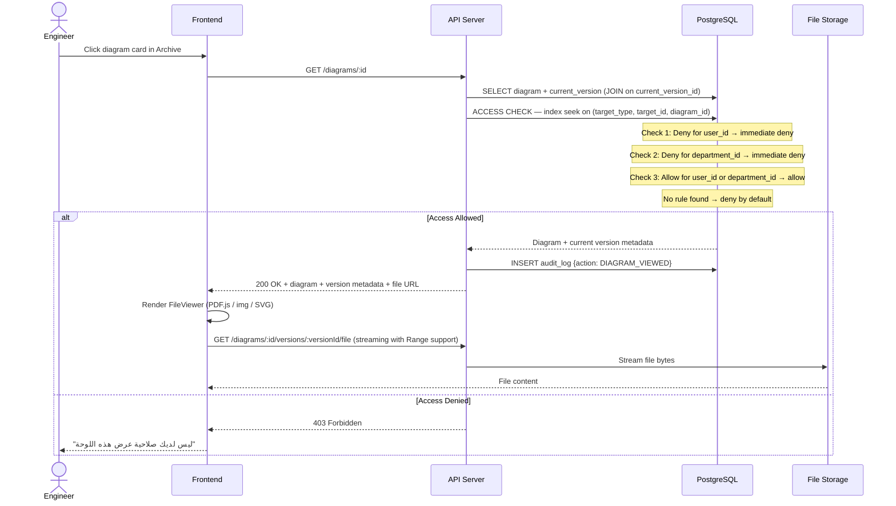
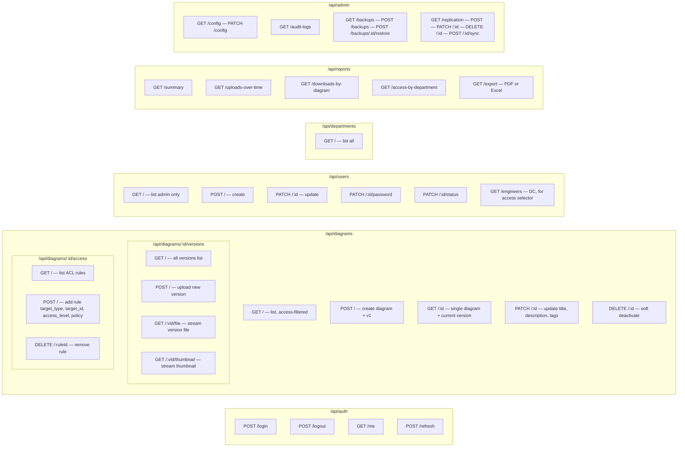
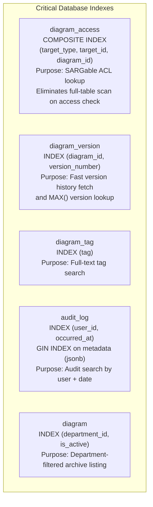

# Diagram Management System — Comprehensive Development Plan

**Project Codename:** DMS (Diagram Management System)
**Version:** 2.0
**Date:** 2026-03-29
**Deployment Model:** On-Premises (fully air-gapped capable)

---

## Table of Contents

1. [Software Requirements Specification (SRS)](#1-software-requirements-specification)
2. [System Design Models (Mermaid)](#2-system-design-models)
3. [Technology Stack Recommendation](#3-technology-stack)
4. [Task Breakdown & AI Agent Prompts](#4-task-breakdown--ai-agent-prompts)

---

# 1. Software Requirements Specification

## 1.1 Introduction

### 1.1.1 Purpose
This document specifies the requirements for the Diagram Management System (DMS), a fully on-premises web application that enables structured archiving, controlled distribution, and access management of engineering diagrams across a multi-department organization.

### 1.1.2 Scope
The DMS provides:
- Secure, role-based diagram repository with immutable version history
- Department-owned diagrams with hierarchical, polymorphic access control
- Format-agnostic archival (PDF, JPEG, PNG, SVG, DWG)
- Administrative oversight and data governance
- Statistics and reporting dashboard
- Full on-premises deployment with no external dependencies

### 1.1.3 Definitions & Acronyms

| Term | Definition |
|------|-----------|
| DC | Document Control — responsible for uploading and distributing approved diagrams |
| DWG | AutoCAD native drawing format |
| SRS | Software Requirements Specification |
| RBAC | Role-Based Access Control |
| Diagram | The logical concept (identity) — persists for years, owns tags and permissions |
| Diagram Version | A specific physical file revision attached to a Diagram |
| Polymorphic ACL | An access rule targeting either an individual user or an entire department via a single table |
| Deny-Override | An access control policy where an explicit Deny record always takes precedence over any Allow |
| On-Premises | Deployed and operated entirely within the organization's own infrastructure |

### 1.1.4 System Users Overview

| Role | Arabic | Responsibilities |
|------|--------|-----------------|
| Engineer | مهندس | View, download, and print diagrams accessible to them |
| Document Control | مراقب الوثائق | Upload approved diagrams, manage versions, assign access |
| Manager | مدير | View statistics and reports |
| Admin | مسؤول النظام | System configuration, user management, backup, replication |

---

## 1.2 Overall Description

### 1.2.1 User Classes and Characteristics

#### Engineer
- Belongs to exactly **one** of the following departments:
  - الري (Irrigation)
  - الصيانة (Maintenance)
  - التسليم (Delivery/Handover)
  - المكتب الفني (Technical Office)
  - الإنشاءات (Construction)
- Can **view** the latest version of any diagram where they hold an active Allow access grant
- Can **download** any accessible diagram
- Can **print** any accessible diagram
- Cannot upload, edit metadata, manage access rules, or create versions
- A Deny grant targeting their user ID or their department always overrides any Allow

#### Document Control (DC)
- Uploads approved diagrams (creating the first version) and new revisions (adding subsequent versions)
- Assigns the owning department to each diagram at creation time
- Sets metadata: title, description, tags
- Sets version-level metadata: revision label (e.g., "Rev A"), change summary, file
- Manages access by granting Allow or Deny rules targeting individual engineers or entire departments
- Can soft-delete (deactivate) a diagram, hiding all its versions from engineers
- Cannot access system configuration or user management

#### Manager
- Views dashboards showing upload/download activity, per-department summaries, and storage metrics
- Exports reports in PDF or Excel format
- Has read-only access to all diagrams for reporting purposes
- Cannot upload diagrams or manage users

#### Admin
- Full system configuration (storage paths, session settings, LDAP integration)
- User management (create, edit, deactivate, assign roles and departments)
- Configures and triggers data replication to secondary on-premises servers
- Manages backup schedules, triggers manual backups, and restores from backup
- Views and searches the full audit trail

---

### 1.2.2 Supported File Formats

| Format | MIME Type | Viewer Strategy |
|--------|-----------|-----------------|
| PDF | application/pdf | In-browser via PDF.js |
| JPEG | image/jpeg | `` tag |
| PNG | image/png | `` tag |
| SVG | image/svg+xml | Sanitized inline render |
| DWG | application/acad | Download-only; thumbnail via LibreCAD CLI (optional) |

---

## 1.3 Functional Requirements

### FR-01: Authentication & Session Management
- FR-01.1: The system shall provide a login page with username and password fields.
- FR-01.2: Passwords shall be hashed using bcrypt (minimum cost factor 12).
- FR-01.3: Sessions shall expire after a configurable idle period (default: 30 minutes).
- FR-01.4: Failed login attempts exceeding 5 shall lock the account for a configurable duration (default: 15 minutes).
- FR-01.5: The system shall support optional LDAP/Active Directory integration for authentication.
- FR-01.6: Role and department shall be embedded in the session token.

### FR-02: Engineer — Diagram Access
- FR-02.1: Engineers shall only see diagrams for which a computed access check results in Allow, after applying Deny-Override logic.
- FR-02.2: Access resolution order: (1) Check for a Deny rule targeting the user directly → deny immediately. (2) Check for a Deny rule targeting the user's department → deny immediately. (3) Check for an Allow rule targeting the user or department → allow. (4) No matching rule → deny by default.
- FR-02.3: Engineers shall always see the **latest version** of any accessible diagram (identified by `DIAGRAM.current_version_id`).
- FR-02.4: Engineers shall be able to view diagrams in-browser for supported formats (PDF, JPEG, PNG, SVG).
- FR-02.5: Engineers shall be able to download any accessible diagram version.
- FR-02.6: Engineers shall be able to trigger a print action for any accessible diagram.
- FR-02.7: Engineers shall be able to browse the version history of a diagram (view metadata only; download any prior version).
- FR-02.8: Engineers shall be able to search and filter accessible diagrams by title, tag, revision label, date range, and file format.

### FR-03: Document Control — Upload & Version Management
- FR-03.1: DC shall create a new **Diagram** record with: title, description, owning department, and optional tags.
- FR-03.2: When creating a diagram, DC shall simultaneously upload the first file, which becomes **Version 1** of the diagram.
- FR-03.3: Each version record shall capture: revision label (required), change summary (required), file, and upload timestamp.
- FR-03.4: Uploaded version files are **immutable** — once stored, a version's file is never modified or overwritten.
- FR-03.5: DC shall upload subsequent revisions to any existing diagram, incrementing the version number and updating `current_version_id`.
- FR-03.6: Maximum file size per upload shall be configurable (default: 200 MB).
- FR-03.7: DC shall manage access rules per diagram using the polymorphic ACL model:
  - Grant or Deny access to an individual engineer (target_type = 'user')
  - Grant or Deny access to an entire department (target_type = 'department')
  - A Deny rule always overrides any Allow rule
- FR-03.8: DC shall be able to remove existing access rules.
- FR-03.9: DC shall be able to deactivate (soft-delete) a diagram, hiding it and all its versions from engineers.

### FR-04: Manager — Reports & Statistics
- FR-04.1: The manager dashboard shall display: total active diagrams, uploads per period (chart), top diagrams by download count, per-department access summary, and active users over time.
- FR-04.2: Reports shall be exportable as PDF or Excel.
- FR-04.3: Date range filters shall be available on all charts.

### FR-05: Admin — User Management
- FR-05.1: Admin shall create user accounts with: username, full name, email (optional), role, department (required if role = Engineer), and password.
- FR-05.2: Admin shall edit user details and reset passwords.
- FR-05.3: Admin shall activate or deactivate accounts without deletion.

### FR-06: Admin — System Configuration
- FR-06.1: Admin shall configure: file storage root path, maximum upload file size, session timeout, and LDAP parameters.

### FR-07: Admin — Data Replication
- FR-07.1: Admin shall configure one or more secondary replication targets (host, port, label).
- FR-07.2: The system shall support scheduled replication (configurable interval).
- FR-07.3: Admin shall trigger manual replication per target on demand.
- FR-07.4: Replication status (last sync time, status, volume) shall be displayed in the admin panel.
- FR-07.5: Replication shall cover both the file store and the database.

### FR-08: Admin — Backup & Restore
- FR-08.1: Admin shall configure automated backup schedule (daily/weekly).
- FR-08.2: Admin shall trigger manual backup on demand.
- FR-08.3: Backups shall include both the file store and a database dump.
- FR-08.4: Admin shall restore the system from a selected backup, with a typed confirmation step.

### FR-09: Audit Logging
- FR-09.1: The system shall log all significant events: login, logout, upload, new version, download, print, access rule changed, user created/modified, backup triggered, restore triggered, replication triggered.
- FR-09.2: Each log entry shall include: timestamp, user, action, target type, target ID, IP address, and a JSONB metadata payload.
- FR-09.3: Admin shall search and filter audit logs by user, action type, and date range.

---

## 1.4 Non-Functional Requirements

| ID | Category | Requirement |
|----|----------|-------------|
| NFR-01 | Performance | Page load < 2s on LAN; access check query < 50ms using composite index on (target_type, target_id, diagram_id) |
| NFR-02 | Scalability | Support up to 500 concurrent users and 100,000 diagram version records |
| NFR-03 | Security | HTTPS enforced; Deny-Override RBAC on every endpoint; immutable version files |
| NFR-04 | Auditability | Every version carries a change_summary; every action is logged with JSONB metadata |
| NFR-05 | Localization | UI supports Arabic (RTL) and English; language switchable per user |
| NFR-06 | Portability | Docker-based deployment on Ubuntu 22.04 LTS and Windows Server 2019+ |
| NFR-07 | Offline | Fully functional without any internet access |
| NFR-08 | Storage | File store path configurable; NAS/SAN mounts supported |
| NFR-09 | Browser Support | Chrome, Edge, Firefox (latest 2 major versions) |
| NFR-10 | Data Integrity | No DIAGRAM_VERSION row may be updated or deleted after creation |

---

## 1.5 Screen Specifications

### Screen 1: Login Page (صفحة التسجيل)
- Fields: Username, Password
- Actions: Login button, Admin-reset flow for forgotten passwords
- Branding: Organization logo, system name in Arabic and English
- Language toggle (AR / EN)
- Error: Show lock countdown if account is locked

### Screen 2: Dashboard (داشبورد)
- **Engineer:** Recent diagrams shared with me (card grid, sorted by latest version date), quick search
- **DC:** Upload stats (versions this month), recent diagrams list, quick-create button
- **Manager:** KPI cards, upload trend chart, per-department breakdown chart, date range selector, export button
- **Admin:** System health (storage, sessions, last backup, replication targets status), quick-action links, recent audit entries

### Screen 3: Archive / Diagrams Page (صفحة الأرشيف — اللوحات)
- Search (by title, tag, revision label), filter panel (department, file format, date range)
- Grid or table toggle; pagination or infinite scroll
- Each card: thumbnail, title, current revision label, file format badge, latest version date, download button
- DC users see Manage button per card

### Screen 4: Diagram Page (صفحة اللوحة)
- Header: Title, owning department badge, current revision label, file format, latest version date, uploader
- File viewer area (format-specific, see FR-02.4 and FR-02.7)
- Action bar: Download, Print
- Version History panel: sequential list of all versions (version number, revision label, change summary, upload date, file size); any version is downloadable; current is highlighted
- Access Management panel (DC/Admin only): list of current ACL rules (target type, target name, access level, policy badge Allow/Deny); add/remove rule controls

---

# 2. System Design Models

## 2.1 Entity-Relationship Diagram



---

## 2.2 Design Decisions & Rationale

### Decision 1 — Versioning: The Identity/File Split
The `DIAGRAM` table represents the **concept** (identity, tags, permissions) while `DIAGRAM_VERSION` represents each **physical file**. A `current_version_id` pointer on `DIAGRAM` gives instant access to the latest file without an expensive `MAX()` or `ORDER BY` query. When a new revision is uploaded, only this pointer changes — all historical versions remain untouched and queryable. This is critical for safety and legal audits.

### Decision 2 — Access Control: Polymorphic Hierarchical RBAC with Deny-Override
A single `DIAGRAM_ACCESS` table serves both user-level and department-level grants via a `target_type` enum. This reduces table size by ~99% for large departments. The `policy` column (`allow|deny`) implements the **Deny-Override** rule: any explicit Deny (by user or department) takes precedence over any Allow. This handles the real-world "whole department has access except the intern" scenario without complex query joins.

### Decision 3 — Data Integrity: Immutable Versions
No `DIAGRAM_VERSION` row is ever updated after creation. The `change_summary` field captures the "why" behind each revision. Together, this creates a forensic-quality audit trail of who uploaded what file, when, and why.

### Decision 4 — PostgreSQL Optimization: SARGable Indexing
Enums (`target_type`, `policy`, `status`) are stored as 4-byte OIDs internally by PostgreSQL. A composite index on `(target_type, target_id, diagram_id)` in `DIAGRAM_ACCESS` is fully SARGable, meaning the database engine can seek directly to a user's or department's permissions rather than scanning the whole table. The `AUDIT_LOG.metadata` column uses `jsonb` (not `json`) to allow GIN indexing on nested keys for fast audit queries.

---

## 2.3 Access Control Resolution Flow



---

## 2.4 Use Case Diagram



---

## 2.5 System Architecture Diagram

```mermaid
flowchart TB
    subgraph Client["Browser Client (LAN)"]
        UI[React SPA]
    end

    subgraph AppServer["Application Server (On-Premises)"]
        direction TB
        NGINX[NGINX — Reverse Proxy + HTTPS + Static Files]
        API[REST API — Node.js / Express / TypeScript]
        ACL[Access Resolver — Deny-Override Logic]
        JOBS[Background Jobs — BullMQ + Redis]
        API --> ACL
    end

    subgraph Storage["File Storage"]
        FS[Local File System / NAS Mount\n/var/dms/files/{year}/{month}/{uuid}.ext]
        THUMB[Thumbnail Cache\n/var/dms/files/thumbs/]
    end

    subgraph DB["Database Server"]
        PG[(PostgreSQL 15\nwith JSONB & ENUM indexes)]
    end

    subgraph ReplicationLayer["Secondary Servers — Optional"]
        S2[Secondary Server 1]
        S3[Secondary Server 2]
    end

    subgraph BackupStore["Backup Storage"]
        BK[/var/dms/backups/]
    end

    UI -- HTTPS / REST --> NGINX
    NGINX --> API
    API --> PG
    API --> FS
    JOBS -- rsync + pg_dump --> S2 & S3
    JOBS -- pg_dump + tar --> BK
```

---

## 2.6 Sequence Diagrams

### 2.6.1 Login Flow



---

### 2.6.2 DC Creates Diagram & Uploads First Version



---

### 2.6.3 DC Uploads New Version (Revision)



---

### 2.6.4 Engineer Access Check & View Diagram



---

## 2.7 Component Diagram (Frontend)

```mermaid
flowchart TD
    subgraph Pages
        Login[LoginPage]
        Dashboard[DashboardPage\nRole-Dispatched]
        Archive[ArchivePage]
        DiagramView[DiagramPage]
        AdminPanel[AdminLayout + Sub-pages]
        Reports[ReportsPage]
    end

    subgraph DiagramComponents["Diagram Components"]
        DiagramCard[DiagramCard\nThumbnail, Rev Label, Format Badge]
        FileViewer[FileViewer\nPDF.js / img / SVG / DWG Placeholder]
        VersionHistory[VersionHistoryPanel\nSequential, Immutable List]
        AccessManager[AccessManager\nPolymorphic ACL Editor]
        UploadForm[CreateDiagramModal\nStep 1: File + Step 2: Meta + Step 3: Access]
        RevisionModal[UploadRevisionModal\nRev Label + Change Summary + File]
    end

    subgraph SharedComponents["Shared UI"]
        NavBar[NavBar + Role Menu]
        SearchBar[SearchBar + Filters]
        DataTable[DataTable — TanStack Table]
        Charts[ChartWidgets — Recharts]
        AuditTable[AuditLogTable]
    end

    subgraph AdminComponents["Admin Components"]
        UserForm[UserFormModal]
        BackupPanel[BackupPanel]
        ReplicationPanel[ReplicationPanel]
        ConfigForm[SystemConfigForm]
    end

    Archive --> SearchBar
    Archive --> DiagramCard
    Archive --> UploadForm
    DiagramView --> FileViewer
    DiagramView --> VersionHistory
    DiagramView --> AccessManager
    DiagramView --> RevisionModal
    Dashboard --> Charts
    AdminPanel --> UserForm & BackupPanel & ReplicationPanel & ConfigForm & AuditTable
    Reports --> Charts & DataTable
```



---

## 2.8 API Route Map



---

## 2.9 Database Index Strategy



---

## 2.10 Deployment Diagram

```mermaid
flowchart TB
    subgraph PrimaryServer["Primary Application Server (On-Premises)"]
        direction TB
        NGINX2[NGINX — Reverse Proxy + HTTPS + Static]
        APP[Node.js App — Port 3000]
        REDIS[Redis 7 — BullMQ Queues]
        PG_PRIMARY[(PostgreSQL 15\nPrimary)]
        FILES[/var/dms/files]
        BACKUPS[/var/dms/backups]

        NGINX2 --> APP
        APP --> PG_PRIMARY
        APP --> FILES
        APP --> REDIS
    end

    subgraph Workers["Background Workers — Same Container"]
        W1[Thumbnail Worker]
        W2[Backup Worker]
        W3[Replication Worker]
    end

    subgraph SecondaryServer["Secondary Server (Optional Replication Target)"]
        PG_REPLICA[(PostgreSQL\nReplica)]
        FILES2[/var/dms/files\nReplicated via rsync]
    end

    subgraph Clients["Client Machines — LAN Only"]
        B1[Engineer Browser]
        B2[DC Browser]
        B3[Manager Browser]
        B4[Admin Browser]
    end

    B1 & B2 & B3 & B4 -- HTTPS LAN --> NGINX2
    REDIS --> W1 & W2 & W3
    W2 -- pg_dump + tar --> BACKUPS
    W3 -- rsync + pg_dump --> SecondaryServer
```

---

# 3. Technology Stack

| Layer | Technology | Rationale |
|-------|-----------|-----------|
| Frontend | React 18 + TypeScript | Component-based, wide ecosystem, strong RTL support |
| Styling | Tailwind CSS + shadcn/ui | Utility-first; RTL via logical properties and `dir` attribute |
| PDF Viewer | PDF.js (pdfjs-dist) | Fully offline; no CDN dependency |
| State | Zustand | Lightweight global state for auth and UI |
| API Client | Axios + React Query v5 | Caching, background refresh, optimistic updates |
| Backend | Node.js 20 + Express + TypeScript | Unified JS stack; excellent file streaming support |
| ORM | Prisma 5 | Type-safe; first-class enum and JSON support for PostgreSQL |
| Database | PostgreSQL 15 | JSONB, ENUMs as OIDs, SARGable composite indexes |
| File Processing | Sharp (images + SVG) | Fast JPEG/PNG/SVG thumbnail generation |
| DWG Preview | LibreCAD CLI (optional) | Converts DWG → PDF → JPEG thumbnail; air-gap safe |
| Auth | JWT (15 min) + Refresh Token (httpOnly cookie, 7 days) | Stateless; httpOnly cookie prevents XSS token theft |
| Job Queue | BullMQ + Redis | Thumbnail generation, backup, replication as named queues |
| Reverse Proxy | NGINX | TLS termination, static file serving, `client_max_body_size` |
| Backup | `pg_dump` + `tar` + `node-cron` | Simple, reliable, no external tooling |
| Replication | `rsync` (files) + `pg_dump` piped to remote | On-premises; no cloud dependency |
| Containerization | Docker + Docker Compose | Reproducible deployment on Linux and Windows Server |

---

# 4. Task Breakdown & AI Agent Prompts

Each task is a self-contained development unit. Paste the prompt directly into an AI coding agent (Claude Code, Cursor, Copilot Workspace, etc.).

---

## PHASE 1: Project Scaffold & Infrastructure

---

### TASK-001 — Project Monorepo Setup

**Priority:** P0 | **Estimate:** 2h

**Prompt:**
```
Create a Node.js monorepo with npm workspaces:

Root structure:
/
├── packages/
│   ├── backend/          # Express + TypeScript API
│   └── frontend/         # React + TypeScript + Vite SPA
├── docker-compose.yml
├── .env.example
└── README.md

Backend dependencies: express, typescript@5, prisma@5, @prisma/client, bullmq, ioredis, sharp, pdf2pic, multer, cors, helmet, jsonwebtoken, bcrypt, zod, node-cron, exceljs, pdfkit, node-ssh

Frontend dependencies: react@18, typescript@5, vite@5, tailwindcss@3, @tailwindcss/forms, tailwindcss-rtl, shadcn/ui (init via CLI), @tanstack/react-query@5, zustand, axios, react-router-dom@6, pdfjs-dist, react-dropzone, react-hook-form, @hookform/resolvers, zod, recharts, i18next, react-i18next, date-fns, dompurify

docker-compose.yml services:
- postgres: postgres:15-alpine, named volume pg_data, healthcheck
- redis: redis:7-alpine, named volume redis_data, healthcheck
- backend: build packages/backend, depends_on postgres+redis (healthy), env_file .env, mount FILE_STORAGE_PATH and BACKUP_PATH as volumes
- frontend: build packages/frontend, NGINX serving built React app, proxy /api and /files to backend

.env.example variables:
DATABASE_URL, REDIS_URL, JWT_SECRET, JWT_REFRESH_SECRET, FILE_STORAGE_PATH=/var/dms/files, BACKUP_PATH=/var/dms/backups, PORT=3000, FRONTEND_URL, MAX_UPLOAD_SIZE_MB=200, SESSION_TIMEOUT_MINUTES=30

Add root Makefile: dev, build, migrate, seed, docker-up, docker-down targets.
Configure ESLint + Prettier for both packages with TypeScript strict mode.
```

---

### TASK-002 — Database Schema & Migrations

**Priority:** P0 | **Estimate:** 3h

**Prompt:**
```
In packages/backend, create a complete Prisma schema at prisma/schema.prisma.

Models:

1. Department: id, nameAr, nameEn, code (unique)

2. User: id, username (unique), fullName, email (optional), passwordHash, role (enum: ENGINEER, DC, MANAGER, ADMIN), departmentId (optional FK → Department), isActive (default true), failedLoginAttempts (default 0), lockedUntil (optional DateTime), lastLogin (optional DateTime), createdAt, updatedAt

3. Diagram: id, title, description (optional), departmentId (FK → Department, "owning department"), currentVersionId (optional Int, NOT a FK relation — store as plain Int to avoid circular Prisma relation; resolve in application code), isActive (default true), createdAt, updatedAt

4. DiagramVersion: id, diagramId (FK → Diagram), versionNumber (Int), revisionLabel (String, e.g. "Rev A"), changeSummary (String), filePath (String — immutable once set), originalFilename (String), fileFormat (enum: PDF, JPEG, PNG, SVG, DWG), fileSizeBytes (BigInt), thumbnailPath (optional String), uploadedById (FK → User), uploadedAt
   CONSTRAINT: Add @@unique([diagramId, versionNumber])
   NOTE: This model must NEVER be updated after creation. Enforce this at the API layer — no PATCH route for versions.

5. DiagramAccess: id, diagramId (FK → Diagram), targetType (enum: USER, DEPARTMENT), targetId (Int — User ID or Department ID depending on targetType), accessLevel (enum: VIEW, EDIT, ADMIN), policy (enum: ALLOW, DENY), grantedAt, grantedById (FK → User)
   INDEX: @@index([targetType, targetId, diagramId]) — composite SARGable index for ACL lookups

6. DiagramTag: id, diagramId (FK → Diagram), tag (String)
   INDEX: @@index([tag])

7. AuditLog: id, userId (optional FK → User), action (String), targetType (optional String), targetId (optional String), ipAddress (optional String), metadata (Json), occurredAt (DateTime default now())

8. BackupRecord: id, filePath, sizeBytes (BigInt), status (enum: RUNNING, SUCCESS, FAILED), startedAt, completedAt (optional), triggeredById (optional FK → User)

9. ReplicationTarget: id, host, port (default 22), label, sshUsername (String), sshKeyPath (String — path to private key on server, NOT stored password), isActive (default true), lastSyncAt (optional), lastSyncStatus (enum: SUCCESS, FAILED, NEVER, default NEVER), createdAt

10. SystemConfig: key (String @id), value (String), updatedAt, updatedById (optional FK → User)

After schema:
- Generate initial migration: npx prisma migrate dev --name init
- Create prisma/seed.ts:
  - Insert 5 departments: {code: 'IRR', nameAr: 'الري', nameEn: 'Irrigation'}, {code: 'MAINT', nameAr: 'الصيانة', nameEn: 'Maintenance'}, {code: 'DEL', nameAr: 'التسليم', nameEn: 'Delivery'}, {code: 'TECH', nameAr: 'المكتب الفني', nameEn: 'Technical Office'}, {code: 'CONST', nameAr: 'الإنشاءات', nameEn: 'Construction'}
  - Create admin user: username=admin, password=Admin@123 (bcrypt hashed), role=ADMIN
  - Create one DC user, one Manager, one Engineer per department (10 engineers total)
  - Insert default SystemConfig: max_upload_size_mb=200, session_timeout_minutes=30
- Run: npx prisma db seed
```

---

### TASK-003 — NGINX + Docker Compose + SSL

**Priority:** P0 | **Estimate:** 2h

**Prompt:**
```
Create production-ready Docker and NGINX configuration:

packages/backend/Dockerfile (multi-stage):
  Stage 1 (build): node:20-alpine, copy package.json + prisma, npm ci, npx prisma generate, copy src, npx tsc
  Stage 2 (prod): node:20-alpine, copy built files + node_modules (prod only), expose 3000, CMD node dist/index.js
  Optional ARG INSTALL_LIBRECAD=false: if true, install librecad via apk

packages/frontend/Dockerfile (multi-stage):
  Stage 1 (build): node:20-alpine, npm ci, npm run build (vite build)
  Stage 2 (serve): nginx:1.25-alpine, copy dist to /usr/share/nginx/html, copy nginx/app.conf to /etc/nginx/conf.d/default.conf

nginx/nginx.conf (main):
  worker_processes auto;
  events { worker_connections 1024; }
  http { gzip on; include /etc/nginx/conf.d/*.conf; }

nginx/app.conf (server block):
  listen 443 ssl;
  ssl_certificate /etc/nginx/certs/dms.crt;
  ssl_certificate_key /etc/nginx/certs/dms.key;
  client_max_body_size 500m;
  Security headers: X-Frame-Options SAMEORIGIN, X-Content-Type-Options nosniff, Strict-Transport-Security
  location / → serve /usr/share/nginx/html, try_files $uri $uri/ /index.html
  location /api/ → proxy_pass http://backend:3000/api/, proxy_request_buffering off (important for large uploads)
  location /files/ → proxy_pass http://backend:3000/files/, proxy_buffering off (important for streaming)

Also redirect HTTP (port 80) → HTTPS.

scripts/generate-cert.sh:
  Generates self-signed cert for a given hostname (arg $1, default: dms.local)
  Output: nginx/certs/dms.crt and dms.key
  Validity: 3650 days

Add .dockerignore files. Document the full docker-compose up flow in README.md.
```

---

## PHASE 2: Backend — Core API

---

### TASK-004 — Auth Middleware & JWT Utilities

**Priority:** P0 | **Estimate:** 3h

**Prompt:**
```
In packages/backend, implement the complete authentication system:

src/utils/auth.ts:
  - generateAccessToken(user: {id, role, departmentId}): JWT, signed with JWT_SECRET, expires 15m, payload: {sub: userId, role, departmentId}
  - generateRefreshToken(userId): JWT, signed with JWT_REFRESH_SECRET, expires 7d
  - verifyAccessToken(token): decoded payload or throws TokenExpiredError / JsonWebTokenError
  - hashPassword(plain): bcrypt, cost 12
  - comparePassword(plain, hash): bcrypt.compare

src/middleware/authenticate.ts:
  - Read JWT from Authorization: Bearer header; fall back to cookie 'accessToken'
  - Attach req.user = {id, role, departmentId} on success
  - On expired: attempt refresh using refreshToken cookie → generate new accessToken → set new cookie → continue
  - On invalid: return 401

src/middleware/authorize.ts:
  - authorize(...roles: Role[]): middleware; check req.user.role ∈ roles; return 403 if not

src/utils/auditLog.ts:
  - logAction(prisma, {userId?, action, targetType?, targetId?, ipAddress?, metadata?}): Promise<void>
  - Fire-and-forget (catch and log error, don't throw)

src/routes/auth.ts:
  POST /api/auth/login:
    - Zod: {username: string, password: string}
    - Fetch user; check isActive; check lockedUntil
    - comparePassword; on fail: increment failedLoginAttempts, lock if >= 5 (lockedUntil = now + 15min)
    - On success: reset failedLoginAttempts, update lastLogin, logAction LOGIN
    - Response: {accessToken, user: {id, username, fullName, role, departmentId}}
    - Set refreshToken as httpOnly, sameSite=strict cookie

  POST /api/auth/logout:
    - Clear refreshToken cookie
    - logAction LOGOUT
    - Return 200

  GET /api/auth/me:
    - authenticate middleware
    - Return req.user joined with full user record (no passwordHash)

  POST /api/auth/refresh:
    - Read refreshToken cookie; verify with JWT_REFRESH_SECRET
    - Generate new accessToken; return it; set new cookie
```

---

### TASK-005 — Access Control Resolver

**Priority:** P0 | **Estimate:** 2h

**Prompt:**
```
In packages/backend, implement the access resolution engine as a reusable module:

src/utils/accessResolver.ts:

Export async function canAccessDiagram(
  prisma: PrismaClient,
  userId: number,
  departmentId: number | null,
  diagramId: number
): Promise<boolean>

Logic (Deny-Override, in strict order):
  1. Query DiagramAccess WHERE diagramId = diagramId AND (
       (targetType = USER AND targetId = userId AND policy = DENY)
       OR (targetType = DEPARTMENT AND targetId = departmentId AND policy = DENY)
     ) LIMIT 1
     → If any row found: return false (deny wins immediately)

  2. Query DiagramAccess WHERE diagramId = diagramId AND (
       (targetType = USER AND targetId = userId AND policy = ALLOW)
       OR (targetType = DEPARTMENT AND targetId = departmentId AND policy = ALLOW)
     ) LIMIT 1
     → If any row found: return true

  3. Return false (default deny — no matching rule)

Export async function getAccessibleDiagramIds(
  prisma: PrismaClient,
  userId: number,
  departmentId: number | null
): Promise<number[]>
  - Used for archive listing queries
  - Returns IDs of all diagrams the user can access
  - Approach: fetch all ALLOW targets for userId/departmentId, subtract any DENY targets
  - Optimize: single query using Prisma groupBy or raw SQL with NOT EXISTS subquery

Export middleware checkDiagramAccess:
  - Express middleware factory: checkDiagramAccess(paramName = 'id')
  - Reads diagramId from req.params[paramName]
  - Calls canAccessDiagram; on false → 403
  - On true → next()
  - DC and ADMIN roles bypass the access check entirely (they see all diagrams)

Write unit tests for the resolver covering:
  - User-level Deny overrides department-level Allow
  - Department-level Deny overrides user-level Allow
  - No rule → deny
  - Allow without any Deny → allow
```

---

### TASK-006 — File Upload, Thumbnail, & Diagram CRUD API

**Priority:** P0 | **Estimate:** 6h

**Prompt:**
```
In packages/backend, implement the Diagrams and Versions API:

src/utils/storage.ts:
  - Configure multer diskStorage: destination = {FILE_STORAGE_PATH}/{YYYY}/{MM}/; filename = {uuid}{ext}
  - Filter: allow only .pdf, .jpg, .jpeg, .png, .svg, .dwg; reject others with 400 + cleanup
  - Read max size from SystemConfig (cache for 60s); fallback to env MAX_UPLOAD_SIZE_MB

src/utils/thumbnail.ts:
  generateThumbnail(filePath, fileFormat, outputDir): Promise<string | null>
    PDF: use pdf2pic (page 1) → resize with Sharp to 400×300 JPEG → return path
    JPEG/PNG: Sharp resize to 400×300 JPEG → return path
    SVG: Sharp (handles SVG natively) → resize to 400×300 JPEG → return path
    DWG: return null (handled by optional LibreCAD worker)

src/queues/thumbnail.queue.ts: BullMQ queue 'thumbnail', job data: {versionId, filePath, fileFormat}

src/workers/thumbnail.worker.ts: Process queue; call generateThumbnail; UPDATE diagram_version SET thumbnailPath WHERE id = versionId

Routes in src/routes/diagrams.ts:

POST /api/diagrams (DC only) — Create Diagram + Version 1:
  - multer single upload
  - Zod body: {title, description?, departmentId, tags?: string, revisionLabel, changeSummary}
  - TRANSACTION:
      1. INSERT diagram {title, description, departmentId, isActive=true}
      2. INSERT diagram_version {diagramId, versionNumber=1, revisionLabel, changeSummary, filePath, ...}
      3. UPDATE diagram SET currentVersionId = new versionId
      4. INSERT diagram_tags (split comma-separated tags)
      5. logAction DIAGRAM_CREATED
  - Enqueue thumbnail job
  - Return 201 + {diagram, version}

GET /api/diagrams (authenticated):
  ENGINEER: call getAccessibleDiagramIds → WHERE id IN (...) AND is_active = true
  DC/ADMIN/MANAGER: WHERE is_active = true
  Each result: JOIN to current diagram_version (using currentVersionId)
  Query params: search (title ILIKE or tag match), fileFormat, departmentId, uploadedFrom, uploadedTo, page, limit
  Return: {data: DiagramSummary[], total, page, limit}

GET /api/diagrams/:id (authenticated + checkDiagramAccess):
  Return diagram + current version + all tags + version count

PATCH /api/diagrams/:id (DC only):
  Update title, description; replace tags (delete old, insert new)
  logAction DIAGRAM_UPDATED

DELETE /api/diagrams/:id (DC/ADMIN):
  SET isActive = false; logAction DIAGRAM_DEACTIVATED

--- Version routes ---

GET /api/diagrams/:id/versions (authenticated + checkDiagramAccess):
  Return all DiagramVersion rows for this diagram, ORDER BY versionNumber ASC

POST /api/diagrams/:id/versions (DC only):
  Zod body: {revisionLabel, changeSummary}; multer file required
  SELECT MAX(versionNumber) from diagram_version WHERE diagramId = :id
  TRANSACTION:
    1. INSERT diagram_version {versionNumber = max + 1, ...}
    2. UPDATE diagram SET currentVersionId = new versionId
    3. logAction VERSION_UPLOADED {metadata: {versionNumber, revisionLabel}}
  Enqueue thumbnail job
  Return 201 + new version record

GET /api/diagrams/:id/versions/:versionId/file (authenticated + checkDiagramAccess):
  Stream file with correct Content-Type; support Range header for partial content
  logAction DIAGRAM_DOWNLOADED {metadata: {versionId, versionNumber}}

GET /api/diagrams/:id/versions/:versionId/thumbnail (authenticated + checkDiagramAccess):
  Stream thumbnail JPEG; 404 if thumbnailPath is null

--- Access routes ---

GET /api/diagrams/:id/access (DC/ADMIN):
  Return all DiagramAccess rows for this diagram, joined with user/department name for display

POST /api/diagrams/:id/access (DC only):
  Zod body: {targetType: 'USER'|'DEPARTMENT', targetId: number, accessLevel: 'VIEW'|'EDIT'|'ADMIN', policy: 'ALLOW'|'DENY'}
  Check no duplicate (same targetType+targetId+diagramId+policy already exists)
  INSERT DiagramAccess; logAction ACCESS_RULE_ADDED

DELETE /api/diagrams/:id/access/:ruleId (DC only):
  DELETE DiagramAccess WHERE id = ruleId AND diagramId = :id
  logAction ACCESS_RULE_REMOVED
```

---

### TASK-007 — Users, Departments, Reports & Admin API

**Priority:** P1 | **Estimate:** 6h

**Prompt:**
```
In packages/backend, implement the remaining API modules:

=== DEPARTMENTS ===
GET /api/departments (authenticated): Return all [{id, nameAr, nameEn, code}]

=== USERS ===
All routes: authenticate + authorize(ADMIN) unless noted.

GET /api/users: paginated list; query params: role, departmentId, isActive, search; join department
GET /api/users/engineers (DC): Return all active ENGINEER users with department; used in access selector
POST /api/users: Zod {username, fullName, email?, role, departmentId (required if ENGINEER), password (min 8)}; hashPassword; logAction USER_CREATED; return 201 (no passwordHash)
PATCH /api/users/:id: update fullName, email, role, departmentId, isActive; guard: cannot change own role; logAction USER_UPDATED
PATCH /api/users/:id/password: Zod {newPassword (min 8)}; hashPassword; logAction PASSWORD_RESET

=== REPORTS ===
All routes: authenticate + authorize(MANAGER, ADMIN); accept query params from, to (ISO dates).

GET /api/reports/summary: {totalActiveDiagrams, totalVersions, uploadsThisMonth, downloadsThisMonth (from audit_logs where action=DIAGRAM_DOWNLOADED), activeUsersThisMonth, storageUsedBytes (SUM diagram_version.fileSizeBytes)}
GET /api/reports/uploads-over-time: param granularity (day|week|month); return [{period, count}] grouped by uploadedAt
GET /api/reports/downloads-by-diagram: top 20 diagrams by download count from audit_logs
GET /api/reports/access-by-department: [{departmentId, nameAr, nameEn, diagramCount, downloadCount}]
GET /api/reports/export:
  param format=pdf: use PDFKit, generate document with summary table + charts (as pre-rendered base64 PNG from recharts server-side or simple table data)
  param format=excel: use ExcelJS, 4 sheets (Summary, Uploads Over Time, Top Downloads, By Department)
  Stream with Content-Disposition: attachment

=== ADMIN ===
All routes: authenticate + authorize(ADMIN).

GET /api/admin/config: Return SystemConfig as {key: value} map
PATCH /api/admin/config: Upsert SystemConfig rows; logAction CONFIG_UPDATED

GET /api/admin/audit-logs: Paginated; params: userId, action, from, to; join user.username

GET /api/admin/backups: Return all BackupRecord[]
POST /api/admin/backups: Create BackupRecord {status: RUNNING}; enqueue 'backup' BullMQ job; return 202 {backupRecordId}
POST /api/admin/backups/:id/restore: Require body {confirmToken: 'RESTORE'}; return 400 if wrong token; enqueue 'restore' job; logAction RESTORE_TRIGGERED; return 202

GET /api/admin/replication: Return all ReplicationTarget[] (exclude sshKeyPath from response)
POST /api/admin/replication: Zod {host, port, label, sshUsername, sshKeyPath}; INSERT; return 201
PATCH /api/admin/replication/:id: Update fields
DELETE /api/admin/replication/:id: Hard delete
POST /api/admin/replication/:id/sync: Enqueue 'replication' job {targetId}; return 202

=== BACKGROUND WORKERS ===

src/workers/backup.worker.ts:
  Process 'backup' queue; UPDATE BackupRecord status=RUNNING
  Run: child_process.exec(`pg_dump "${DATABASE_URL}" > "${BACKUP_PATH}/${timestamp}.sql"`)
  Run: child_process.exec(`tar -czf "${BACKUP_PATH}/${timestamp}-files.tar.gz" -C "${FILE_STORAGE_PATH}" .`)
  UPDATE BackupRecord status=SUCCESS/FAILED + completedAt + sizeBytes

src/workers/restore.worker.ts:
  Process 'restore' queue {backupRecordId}
  Read BackupRecord.filePath; run pg restore and file extraction
  logAction RESTORE_COMPLETED

src/workers/replication.worker.ts:
  Process 'replication' queue {targetId}
  Load ReplicationTarget; use node-ssh with sshKeyPath
  rsync FILE_STORAGE_PATH to remote host
  pg_dump and scp SQL to remote
  UPDATE ReplicationTarget lastSyncAt + lastSyncStatus

Initialize all workers in src/workers/index.ts. Import and start from src/index.ts.
```

---

## PHASE 3: Frontend — Core UI

---

### TASK-008 — Frontend Scaffold, Routing & Auth State

**Priority:** P0 | **Estimate:** 3h

**Prompt:**
```
In packages/frontend, set up the complete application shell:

1. src/store/authStore.ts (Zustand + persist to localStorage):
   State: user (null | {id, username, fullName, role, departmentId}), accessToken (string | null), isLoading
   Actions: login({username, password}), logout(), refreshToken(), setUser

2. src/api/client.ts (Axios instance):
   baseURL: /api
   Request interceptor: attach Authorization: Bearer {accessToken}
   Response interceptor: on 401 → call POST /auth/refresh → retry original request once → on second 401 call logout()

3. Configure i18next:
   src/locales/ar.json and en.json with keys for all UI strings
   Detect language from localStorage, default 'ar'
   On language change: update document.documentElement.dir ('rtl'|'ltr') and lang attribute

4. src/hooks/useLanguage.ts:
   Returns {lang, toggleLanguage, isRTL, t}
   Flips dir attribute on html element

5. src/routes/AppRouter.tsx (React Router v6 createBrowserRouter):
   /login → LoginPage (redirect to /dashboard if authed)
   /dashboard → DashboardPage (all authenticated roles)
   /archive → ArchivePage (ENGINEER, DC, ADMIN)
   /diagrams/:id → DiagramPage (ENGINEER, DC, ADMIN — access check done by API)
   /reports → ReportsPage (MANAGER, ADMIN)
   /admin → AdminLayout with nested routes:
     /admin/users, /admin/config, /admin/backups, /admin/replication, /admin/audit
   * → NotFoundPage

6. ProtectedRoute component: checks authStore.user; redirects to /login if null; renders 403 if role not in allowedRoles

7. src/components/layout/AppShell.tsx:
   Top navbar: logo, system title, current user name + role badge, language toggle button, logout button
   Left sidebar (desktop) / Bottom tab bar (mobile): role-filtered navigation links
   Main content area with padding
   RTL: sidebar flips to right when dir=rtl using logical CSS (inset-inline-start)

8. src/utils/format.ts:
   formatDate(date, lang): Arabic or English formatted date string
   formatNumber(n, lang): Intl.NumberFormat with locale 'ar-EG' or 'en-US'
   formatFileSize(bytes, lang): human-readable KB/MB/GB in correct locale
   timeAgo(date, lang): relative time string
```

---

### TASK-009 — Login Page

**Priority:** P0 | **Estimate:** 2h

**Prompt:**
```
Create src/pages/LoginPage.tsx:

Layout: Full-height flex-center page with subtle gradient background (blue-50 to white)
Card: max-w-md, rounded-2xl shadow-lg, padding 8

Content:
  - Organization logo:  with fallback SVG building/blueprint icon
  - Title: "نظام إدارة اللوحات الهندسية" (Engineering Diagram Management System)
  - Subtitle: current year
  - Username field: label "اسم المستخدم", shadcn/ui Input, leading icon (User)
  - Password field: label "كلمة المرور", trailing show/hide toggle icon, Input type=password/text
  - Login button: full-width, primary blue, loading spinner (Loader2 icon) during request
  - Error alert: shadcn/ui Alert (destructive variant):
    Invalid credentials: "اسم المستخدم أو كلمة المرور غير صحيحة"
    Account locked: lock icon + "الحساب محظور — يمكنك المحاولة مجدداً في X دقيقة"
  - Language toggle: top-right corner of page, small button AR | EN

Behavior:
  - React Hook Form + Zod: username required min 3, password required min 6
  - On submit: call authStore.login(); on success navigate('/dashboard')
  - Keyboard: Enter submits
  - Disable button while isLoading or fields invalid
  - After error, keep fields filled (do not reset)

RTL: all labels, inputs and text align right when lang=ar. Use Tailwind logical classes (text-start, ps-, pe-).
```

---

### TASK-010 — Dashboard Pages (Role-Dispatched)

**Priority:** P1 | **Estimate:** 5h

**Prompt:**
```
Create role-specific dashboard components in src/pages/dashboard/:

EngineerDashboard.tsx:
  - Greeting: "مرحباً {fullName}" + formatted date in Arabic
  - "اللوحات الجديدة" section (last 7 days): DiagramCard grid, fetched from GET /diagrams?uploadedFrom=7daysAgo
  - Quick search bar navigates to /archive?search=...
  - Empty state: illustration + "لا توجد لوحات جديدة"

DCDashboard.tsx:
  - Stat row: uploads this month (from GET /reports/summary), total diagrams
  - "+ رفع لوحة جديدة" primary button → opens CreateDiagramModal
  - Recent uploads table: thumbnail, title, current revision label, upload date, viewer rules count, active status

ManagerDashboard.tsx:
  - 4 KPI cards: Total Diagrams, Total Versions, Downloads This Month, Storage Used (formatted)
  - Line chart (Recharts ResponsiveContainer): uploads per month for last 6 months
  - Bar chart: downloads per department
  - DateRangePicker component (from/to) bound to all chart queries via React Query params
  - Export button → GET /reports/export?format=excel | pdf

AdminDashboard.tsx:
  - System health cards: Storage Used (with ProgressBar), Last Backup (time ago + status badge Success/Failed/Running), Replication Targets (each target: label, last sync, status badge)
  - Quick action buttons: "نسخة احتياطية الآن", "إضافة مستخدم", "سجل الأحداث"
  - Recent audit table (last 10 rows): occurred_at, user.username, action, targetType

DashboardPage.tsx:
  - Read role from authStore.user.role
  - Render matching dashboard
  - Wrap in AppShell
  - All data via useQuery hooks with appropriate refetchInterval for health data (30s for admin)
  - Skeleton loading states for each section
```

---

### TASK-011 — Archive Page

**Priority:** P0 | **Estimate:** 4h

**Prompt:**
```
Create src/pages/ArchivePage.tsx and supporting components:

src/components/diagrams/DiagramCard.tsx:
  Props: {diagram: DiagramSummary}
  Display:
    - Thumbnail (GET /diagrams/:id/versions/:currentVersionId/thumbnail) with fallback format icon
    - Format badge: PDF=red, DWG=blue, SVG=green, PNG/JPEG=gray (pill badge)
    - Title (truncated to 2 lines)
    - Revision label badge (e.g. "Rev A") in secondary color
    - Latest version date formatted in locale
    - File size (current version)
  Hover: elevation shadow, show Download button (icon) and Open button
  DC/ADMIN only: gear dropdown → Edit Metadata, Manage Access, Upload Revision, Deactivate

src/components/diagrams/DiagramFilters.tsx:
  - File format checkboxes (PDF, DWG, JPEG, PNG, SVG) with icons
  - Date range pickers: "من" (from) and "إلى" (to)
  - Department multi-select (DC/ADMIN only) fetched from GET /departments
  - "مسح الفلاتر" clear button
  - On desktop: fixed left sidebar; on mobile: slide-in drawer

ArchivePage.tsx:
  - Search bar at top: debounced 300ms, synced to URL ?search=
  - All filter state synced to URL query params (useSearchParams)
  - View toggle: grid (default) / table
  - Grid: responsive 1→2→3→4 columns
  - Table: columns: thumbnail, title, revision, format, department, uploaded by, date, actions
  - Results count: "يتم عرض {from}–{to} من {total} لوحة"
  - Pagination: page size select (10/20/50), page navigation
  - Skeleton: 12 placeholder cards on loading
  - Empty state: illustration + message
  - Error state: retry button
  - Clicking card body → navigate to /diagrams/:id
  - DC floating action button (FAB) bottom-right: "+ رفع لوحة جديدة"

Data: useQuery(['diagrams', params], () => api.get('/diagrams', {params}))
```

---

### TASK-012 — Diagram Page (Viewer + Version History + Access Manager)

**Priority:** P0 | **Estimate:** 6h

**Prompt:**
```
Create src/pages/DiagramPage.tsx and its sub-components:

=== FileViewer (src/components/diagrams/FileViewer.tsx) ===
Props: {versionId, diagramId, fileFormat}

PDF: Load via PDF.js (pdfjs-dist). URL = /api/diagrams/:id/versions/:vId/file.
  Controls: prev/next page, page X of Y input, zoom in/out/fit-width buttons, loading spinner, error state with retry.
  Render canvas element per page.

JPEG/PNG:  src pointing to file URL. object-fit: contain. Full-width up to max-height.
  Click to open full-screen overlay (modal with close button).

SVG: Fetch SVG text via axios GET /api/diagrams/:id/versions/:vId/file.
  Sanitize with DOMPurify.sanitize(svgText, {USE_PROFILES: {svg: true}}).
  Render in div via dangerouslySetInnerHTML.
  Scale to container using viewBox.

DWG: Styled placeholder card: large CAD/blueprint icon, "ملف AutoCAD" title, "يتطلب برنامج متخصص للعرض" subtitle, large Download button.
  Gray dashed border, light blue-gray background.

=== VersionHistoryPanel (src/components/diagrams/VersionHistoryPanel.tsx) ===
Props: {diagramId, currentVersionId, onVersionSelect}
Fetch GET /api/diagrams/:id/versions → ordered list
For each version:
  - Version number badge: "الإصدار {n}"
  - Revision label: e.g. "Rev B"
  - Change summary (full text — this is the "why")
  - Upload date + uploader name
  - File size
  - "الإصدار الحالي" green badge if id === currentVersionId (highlighted row)
  - Download button for that version
  - "عرض" button (updates the FileViewer to show this version without navigating)
Newest version at top.

=== AccessManager (src/components/diagrams/AccessManager.tsx — DC/ADMIN only) ===
Fetch GET /api/diagrams/:id/access
Display list of rules as table rows:
  - Target type icon: person icon (user) or building icon (department)
  - Target name: resolve from user list or department list
  - Access level badge: VIEW/EDIT/ADMIN
  - Policy badge: green ALLOW / red DENY
  - Remove button (trash icon) → DELETE /api/diagrams/:id/access/:ruleId → confirm dialog

"إضافة قاعدة وصول" button → inline form:
  - Target type toggle (مستخدم / قسم)
  - If user: searchable select from GET /users/engineers
  - If department: select from GET /departments
  - Access level select (VIEW default)
  - Policy toggle (ALLOW default / DENY)
  - Submit → POST /api/diagrams/:id/access → invalidate query

=== DiagramPage.tsx ===
Layout (desktop): 2-column — FileViewer (left, 70%) + Sidebar (right, 30%)
Layout (mobile): tabs — Viewer / History / Access (DC/ADMIN)

Header:
  - Back button ← رجوع
  - Title (h1), department badge, current revision label badge, file format badge
  - Upload date + uploader name
  - Action bar: Download button (a href to file URL with download attribute), Print button (window.print() or print-specific CSS)

Sidebar tabs:
  - "سجل الإصدارات": VersionHistoryPanel
  - "إدارة الوصول" (DC/ADMIN only): AccessManager
  - "تعديل البيانات" (DC/ADMIN only): edit form for title, description, tags → PATCH /api/diagrams/:id
  - "إلغاء التفعيل" (DC/ADMIN only): red button with confirmation dialog → DELETE /api/diagrams/:id → navigate to /archive

Print mode: CSS @media print — hide sidebar, navbar, action bar. Print only the FileViewer content.
```

---

### TASK-013 — Create Diagram Modal (Multi-Step)

**Priority:** P1 | **Estimate:** 4h

**Prompt:**
```
Create src/components/diagrams/CreateDiagramModal.tsx — multi-step modal for DC:

Step indicator: 4 steps shown as numbered circles at modal top: File / Metadata / Versions Info / Access

Step 1 — File Upload:
  react-dropzone area accepting .pdf, .jpg, .jpeg, .png, .svg, .dwg
  Show max file size (read from GET /admin/config key max_upload_size_mb)
  After selection: file name, format icon, size, green checkmark
  Reject oversized files with error message inline

Step 2 — Diagram Metadata:
  Title (required): text input
  Description (optional): textarea
  Owning Department (required): select from GET /departments
  Tags (optional): tag-input component (type + Enter to add, × to remove each tag)

Step 3 — Version Information:
  Revision Label (required): text input, placeholder "Rev A" or "Rev 1"
  Change Summary (required): textarea, placeholder "الوصف الأول للمستند / Initial document"
  Upload date: date picker, default today

Step 4 — Access Rules:
  Two-panel layout:
  Left — Engineers: searchable list from GET /users/engineers grouped by department.
    Each entry: avatar initials, name, department.
    Checkbox per user for ALLOW access.
    "تحديد قسم كامل" toggle per department header.
  Right — Quick Department Access:
    5 department checkboxes. Selecting a dept adds DEPARTMENT-level ALLOW rule.
    Warning if mixing individual user rules with department rules for same dept.
  Policy for each rule defaults to ALLOW (DC can add DENY rules later from the diagram page).

Step 5 — Confirmation & Upload:
  Summary: file name, title, revision label, department, viewer count
  Upload button with Axios onUploadProgress → progress bar (0–100%)
  Cancel button
  On success: close modal, invalidate ['diagrams'] cache, show toast "تم إنشاء اللوحة بنجاح"
  On error: show API error, stay on this step

Navigation: Previous / Next buttons. Validate current step before advancing (React Hook Form per step). Step indicators clickable only for completed steps.

Also create src/components/diagrams/UploadRevisionModal.tsx:
  Simplified 2-step modal (Version Info + File only). Pre-populated diagram title shown as read-only context.
  On success: invalidate ['diagrams', id] and ['diagrams', id, 'versions'], show toast "تم رفع الإصدار الجديد".
```

---

### TASK-014 — Admin Pages

**Priority:** P1 | **Estimate:** 6h

**Prompt:**
```
Create all Admin sub-pages in src/pages/admin/:

=== AdminLayout.tsx ===
Left sidebar (desktop) nav: Users, System Config, Backups, Replication, Audit Log
Breadcrumb at top of content area
Nested <Outlet> for sub-page content

=== AdminUsersPage.tsx ===
Filter bar: search (username/name), role select, department select, status toggle (active/inactive)
DataTable (TanStack Table): columns: username, fullName, role badge, department, status chip, lastLogin, actions
Row actions: Edit → UserFormModal (pre-filled), Reset Password → PasswordResetModal, Toggle Active (with confirmation)
"+ إضافة مستخدم" button → UserFormModal (empty)

UserFormModal.tsx:
  React Hook Form + Zod: username, fullName, email, role, departmentId (shown/required if role=ENGINEER), password (required for new, hidden for edit)
  On submit: POST (new) or PATCH /:id (edit) → invalidate users query → close modal → toast

PasswordResetModal.tsx:
  Simple: newPassword (min 8) + confirm password fields → PATCH /users/:id/password

=== AdminConfigPage.tsx ===
Form bound to GET /admin/config:
  Max Upload Size (MB): number input (key: max_upload_size_mb)
  Session Timeout (minutes): number input (key: session_timeout_minutes)
  Collapsible "LDAP Integration" section: ldap_host, ldap_port, ldap_bind_dn, ldap_base_dn
"حفظ التغييرات" button → PATCH /admin/config → toast success
"استعادة الإعدادات" reset to last saved state button

=== AdminBackupsPage.tsx ===
"نسخة احتياطية الآن" button → confirm dialog → POST /admin/backups → toast "جاري إنشاء النسخة الاحتياطية"
Auto-refresh backup list every 10s while any record has status=RUNNING
DataTable: columns: started_at (formatted), size (formatted), status (Running/Success/Failed with icon + color), duration, Restore button
Restore button → confirm dialog: warning text + type "RESTORE" to enable confirm → POST /admin/backups/:id/restore → toast

=== AdminReplicationPage.tsx ===
List of ReplicationTarget cards: label, host:port, SSH user, last sync time ago, status badge, "مزامنة الآن" button, Edit/Delete buttons
"مزامنة الآن" → POST /admin/replication/:id/sync → toast + status badge changes to Running spinner
Auto-refresh every 30s
"+ إضافة هدف" button → form modal: label, host, port (default 22), sshUsername, sshKeyPath (path on server to private key)
Edit modal: same form pre-filled
Delete: confirmation dialog

=== AdminAuditPage.tsx ===
Filter bar: user select (from GET /users), action multi-select (fixed list: LOGIN, LOGOUT, DIAGRAM_CREATED, VERSION_UPLOADED, DIAGRAM_DOWNLOADED, ACCESS_RULE_ADDED, ACCESS_RULE_REMOVED, USER_CREATED, BACKUP_TRIGGERED, RESTORE_TRIGGERED), date range picker
DataTable: columns: occurred_at, user.username, action badge (color-coded), targetType, targetId, ipAddress
Pagination: 50 per page
Expand row to show metadata JSON (formatted)
```

---

## PHASE 4: Advanced Features & Polish

---

### TASK-015 — Notifications System

**Priority:** P2 | **Estimate:** 3h

**Prompt:**
```
Implement an in-app notification system:

Backend — add Notification Prisma model:
  id, userId (FK User), type (enum: NEW_DIAGRAM, NEW_VERSION, SYSTEM), message, isRead (default false), relatedDiagramId (optional Int), createdAt

Backend — when access rules are created (POST /diagrams, POST /diagrams/:id/access):
  For each newly ALLOW-granted user: INSERT Notification {userId, type: NEW_DIAGRAM or NEW_VERSION, message: localized}
  For department-level ALLOW grants: SELECT all engineers in department → INSERT one notification per engineer

Backend routes (authenticate required):
  GET /api/notifications: Return [{id, type, message, isRead, relatedDiagramId, createdAt}], limit 20, unread first. Also return unreadCount.
  PATCH /api/notifications/read-all: UPDATE SET isRead=true WHERE userId=req.user.id
  PATCH /api/notifications/:id/read: UPDATE single notification

Frontend:
  Bell icon in NavBar with unread count badge (red, animated pulse if > 0)
  Popover on click (max-height scrollable list):
    Each notification: type icon, message, time ago in locale, highlighted background if unread
    Click: PATCH /notifications/:id/read → navigate to /diagrams/:relatedDiagramId
    "تحديد الكل كمقروء" button at top
  useQuery with refetchInterval: 60_000 (every minute)
  On navigate to a diagram from notification: mark as read
```

---

### TASK-016 — Internationalization (AR/EN) + RTL Complete Pass

**Priority:** P1 | **Estimate:** 3h

**Prompt:**
```
Complete the i18n and RTL implementation across ALL components in packages/frontend:

1. Audit every component and replace all hardcoded Arabic or English strings with t('namespace.key') calls.

2. Populate src/locales/ar.json and src/locales/en.json completely:
   Namespaces: auth, nav, dashboard, archive, diagram, admin, reports, common, errors, notifications

3. RTL layout rules (apply to ALL components):
   - Replace all directional Tailwind classes with logical equivalents:
     left → start, right → end, pl- → ps-, pr- → pe-, ml- → ms-, mr- → me-
   - Sidebar: inset-inline-start-0 (appears on left in LTR, right in RTL)
   - Directional icons (ChevronLeft/ChevronRight, ArrowLeft/ArrowRight): wrap in a <DirectionalIcon> component that applies transform: scaleX(-1) when isRTL
   - Back button arrow: flips in RTL

4. Date & number formatting using src/utils/format.ts:
   All dates in the UI must go through formatDate(date, lang)
   Arabic locale uses Hijri calendar option via Intl.DateTimeFormat with calendar: 'gregory' but locale 'ar-EG'
   Arabic numerals via Intl.NumberFormat('ar-EG') when lang='ar'

5. FileViewer PDF.js: set document direction attribute for rendered pages if PDF is Arabic

6. DataTable columns: when RTL, text-end alignment for text columns, icon columns stay centered

7. Print styles: set direction correctly in @media print

8. Test checklist (add to README):
   - Switch language → dir attribute flips → sidebar flips sides
   - All text, labels, placeholders translate correctly
   - Numbers render as Arabic-Indic in AR mode
   - Charts axes labels translate
   - Error messages translate
   - Modal and toast messages translate
```

---

### TASK-017 — DWG Thumbnail Generation (Optional Module)

**Priority:** P2 | **Estimate:** 3h

**Prompt:**
```
In packages/backend, implement optional DWG thumbnail generation:

src/utils/dwgThumbnail.ts:
  Export async function generateDwgThumbnail(dwgFilePath: string, outputDir: string): Promise<string | null>

  Strategy 1 — LibreCAD CLI (preferred):
    Check: exec('which librecad') or exec('librecad --version')
    If available: exec(`librecad --export-pdf "${dwgFilePath}" "${tempPdf}"`)
    Then call existing generateThumbnail(tempPdf, 'PDF', outputDir) → returns JPEG path
    Clean up temp PDF

  Strategy 2 — ODA File Converter (Teigha Viewer):
    Check: exec('which ODAFileConverter')
    If available: exec(`ODAFileConverter "${inputDir}" "${outputDir}" ACAD2018 PDF 0 1`)
    Then thumbnail the resulting PDF

  Strategy 3 — Fallback:
    Log warning: 'DWG thumbnail generation unavailable: install LibreCAD or ODA File Converter'
    Return null

Update src/utils/thumbnail.ts:
  In generateThumbnail switch: case 'DWG' → call generateDwgThumbnail()

Create dedicated BullMQ queue 'dwg-thumbnail' with concurrency: 1 (CPU-intensive).
DWG files get queued to 'dwg-thumbnail' instead of the regular 'thumbnail' queue.

Update docker-compose.yml:
  Add build ARG in backend Dockerfile: ARG INSTALL_LIBRECAD=false
  If true: RUN apt-get install -y librecad (or apk add for alpine)
  Document in README under "Optional DWG Preview Support"

Create scripts/test-dwg-thumb.ts:
  Accept argv[2] as DWG file path
  Call generateDwgThumbnail(path, '/tmp/')
  Log result path or 'No thumbnail generated'
  Usage: npx ts-node scripts/test-dwg-thumb.ts ./test.dwg
```

---

### TASK-018 — End-to-End Testing Suite

**Priority:** P2 | **Estimate:** 4h

**Prompt:**
```
Create an E2E test suite in packages/e2e using Playwright:

Setup:
  playwright.config.ts: baseURL = http://localhost:5173, browser = chromium, retries = 1, screenshot + video on failure
  Add npm scripts: test:e2e, test:e2e:headed, test:e2e:ui, test:e2e:report

Test database reset:
  global-setup.ts: reset DB to seeded state via API endpoint POST /api/test/reset (guarded by NODE_ENV=test only)
  Or: run prisma migrate reset --force + seed before test run via Makefile target test:reset

Test fixtures:
  tests/fixtures/files/: small valid test files → sample.pdf (1-page, <1MB), sample.png (100×100), sample.svg, sample.dwg (minimal)

Test helper:
  tests/helpers/auth.ts: loginAs(page, role: 'admin'|'dc'|'manager'|'engineer_irr')
    Uses page.request.post('/api/auth/login', {data: credentials})
    Sets localStorage or cookie for token

tests/auth.spec.ts:
  Valid login → reaches dashboard
  Wrong password → sees error alert
  5 wrong attempts → sees locked message with duration
  Logout → redirected to /login

tests/engineer.spec.ts:
  Login as engineer → dashboard shows shared diagrams
  Click diagram card → diagram page opens with viewer
  Download button → file download triggered (check download event)
  Navigate to /admin → should see 403 or redirect

tests/dc.spec.ts:
  Login as DC → create diagram: upload sample.pdf, fill metadata, set department-level ALLOW for one department → verify diagram appears in archive
  Upload new revision to existing diagram → version history panel shows 2 versions
  Add DENY rule for one engineer → log in as that engineer → diagram not visible
  Deactivate diagram → verify disappears from engineer archive

tests/manager.spec.ts:
  Login as manager → KPI cards show numbers (not NaN or undefined)
  Change date range → network request fires with updated params

tests/admin.spec.ts:
  Create new Engineer user → user appears in list
  Deactivate user → login as that user fails with 401
  Trigger backup → backup record appears in list with status
  Add replication target → target appears in replication list
```

---

### TASK-019 — Deployment & Operations Documentation

**Priority:** P1 | **Estimate:** 2h

**Prompt:**
```
Create operations documentation in packages/docs/:

INSTALL.md:
  Prerequisites: Docker 24+, Docker Compose v2, 4GB RAM minimum, 50GB disk, LAN with static IP for server
  Step-by-step:
    1. Clone repository
    2. cp .env.example .env → fill required values (JWT_SECRET minimum 32 chars, FILE_STORAGE_PATH, BACKUP_PATH)
    3. Create storage directories: mkdir -p /var/dms/files /var/dms/backups
    4. Generate SSL cert: bash scripts/generate-cert.sh dms.yourdomain.local
    5. docker compose up -d
    6. Wait for health checks: docker compose ps
    7. Run migrations: docker compose exec backend npx prisma migrate deploy
    8. Seed database: docker compose exec backend npx prisma db seed
    9. Access: https://dms.yourdomain.local
    10. Default admin: username=admin password=Admin@123 → CHANGE IMMEDIATELY

CONFIGURATION.md:
  Table of all .env variables with type, default, example, description
  SystemConfig keys table: key, description, default, valid range
  LDAP integration guide: how to enable, required AD/LDAP attributes, test command
  NAS/SAN storage mount guide: fstab entry example, permission requirements (chown to docker user)

VERSIONING_GUIDE.md (new — for DC operators):
  Explain the Diagram/Version split in plain terms
  When to create a new Diagram vs. upload a new Version
  Revision label conventions (Rev A, Rev B or Rev 1, Rev 2)
  Importance of the Change Summary field ("why this revision was made")
  Access control guide: Allow vs Deny, user-level vs department-level, Deny-Override rule explained in plain Arabic

BACKUP_RESTORE.md:
  Manual trigger via Admin UI
  Scheduled backup: how to adjust cron via SystemConfig
  Backup file structure: {timestamp}.sql + {timestamp}-files.tar.gz
  Restore procedure step-by-step with warnings
  Verify restore: how to confirm database and files are consistent

REPLICATION.md:
  Prerequisites: SSH key pair, remote server with Docker and sufficient storage
  Adding target via Admin UI: all fields explained
  SSH key setup: generate key pair, copy public key to remote server authorized_keys
  What is replicated: all files (rsync) + database dump
  Monitoring: check Admin → Replication panel for last sync status
  Failover: steps to promote secondary to primary

TROUBLESHOOTING.md:
  Cannot access https://dms.local → check NGINX container status, cert paths
  Upload fails → check client_max_body_size in NGINX, check FILE_STORAGE_PATH permissions
  Login fails for all users → check DATABASE_URL, run docker compose exec backend npx prisma db push
  Thumbnail not showing → check thumbnail worker logs: docker compose logs backend | grep thumbnail
  Reset admin password via CLI: docker compose exec backend node dist/scripts/reset-admin-password.js
  View all logs: docker compose logs -f
  Database connection issues: verify DATABASE_URL format, postgres container health
```

---

## Summary Table

| Task ID | Description | Phase | Priority | Est. Hours |
|---------|-------------|-------|----------|------------|
| TASK-001 | Monorepo Setup | 1 | P0 | 2 |
| TASK-002 | Database Schema & Migrations | 1 | P0 | 3 |
| TASK-003 | NGINX + Docker Compose + SSL | 1 | P0 | 2 |
| TASK-004 | Auth Middleware & JWT | 2 | P0 | 3 |
| TASK-005 | Access Control Resolver (Deny-Override) | 2 | P0 | 2 |
| TASK-006 | File Upload, Thumbnail & Diagram API | 2 | P0 | 6 |
| TASK-007 | Users, Departments, Reports & Admin API | 2 | P1 | 6 |
| TASK-008 | Frontend Scaffold, Routing & Auth State | 3 | P0 | 3 |
| TASK-009 | Login Page | 3 | P0 | 2 |
| TASK-010 | Dashboard Pages (All Roles) | 3 | P1 | 5 |
| TASK-011 | Archive Page | 3 | P0 | 4 |
| TASK-012 | Diagram Page (Viewer + History + Access) | 3 | P0 | 6 |
| TASK-013 | Create Diagram & Upload Revision Modals | 3 | P1 | 4 |
| TASK-014 | Admin Pages | 3 | P1 | 6 |
| TASK-015 | Notifications System | 4 | P2 | 3 |
| TASK-016 | Internationalization (AR/EN + RTL) | 4 | P1 | 3 |
| TASK-017 | DWG Thumbnail (Optional Module) | 4 | P2 | 3 |
| TASK-018 | End-to-End Testing Suite | 4 | P2 | 4 |
| TASK-019 | Deployment & Operations Documentation | 4 | P1 | 2 |
| | **TOTAL** | | | **~73h** |

---

## Recommended Execution Order

```
Week 1:  TASK-001 → TASK-002 → TASK-003 → TASK-004 → TASK-005
Week 2:  TASK-006 → TASK-007 → TASK-008 → TASK-009
Week 3:  TASK-010 → TASK-011 → TASK-012 → TASK-013
Week 4:  TASK-014 → TASK-016 → TASK-015 → TASK-019
Week 5:  TASK-017 → TASK-018 → Integration Testing → UAT
```

---

## Key Architectural Decisions Summary

| Decision | Choice | Impact |
|----------|--------|--------|
| Versioning model | Identity/File split (DIAGRAM + DIAGRAM_VERSION) | Stable links, permissions, and tags across revisions |
| Access control | Polymorphic ACL with Deny-Override | 99% fewer rows for department grants; handles "exclude one user" cases |
| Version immutability | No UPDATE ever on DIAGRAM_VERSION | Legal/safety audit trail integrity |
| DB optimization | ENUM types + SARGable composite index on ACL | Fast access checks without full-table scans |
| Audit metadata | JSONB (not JSON) | GIN-indexable; fast audit search queries |
| SSH credentials | sshKeyPath stored (not password) | Secrets never in database; key file on server only |
| File storage | UUID-named, organized by year/month | No filename collisions; predictable directory structure |
| Thumbnail generation | Async BullMQ queue | Upload response is instant; thumbnail appears later |

---

*End of Document — DMS Comprehensive Development Plan v2.0*
