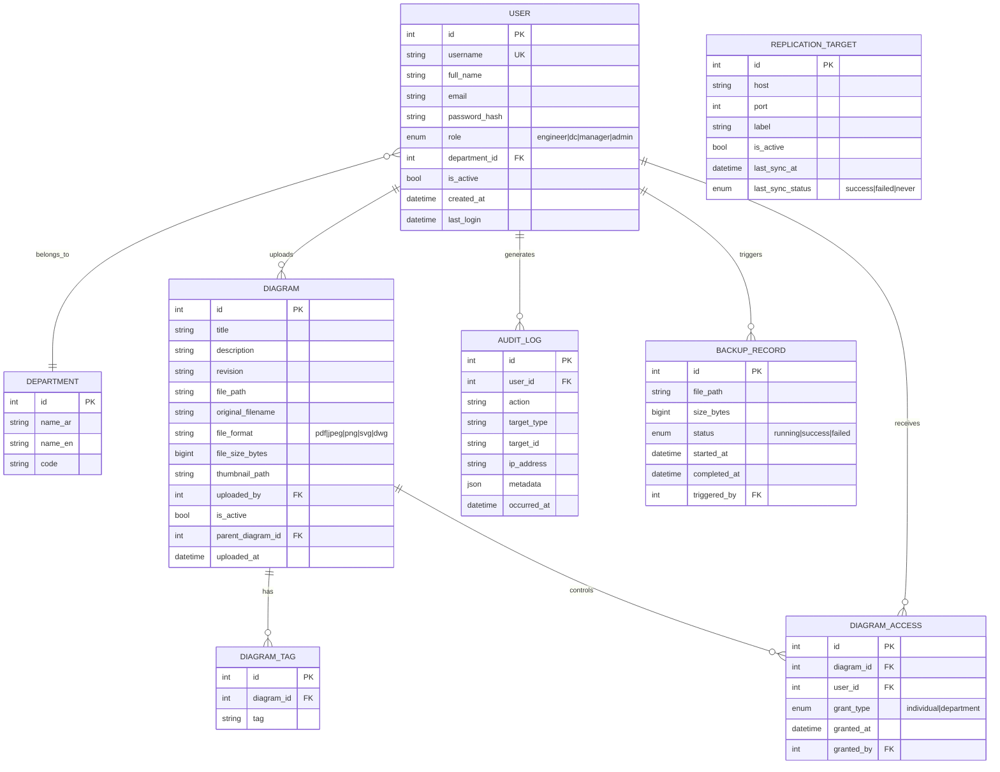
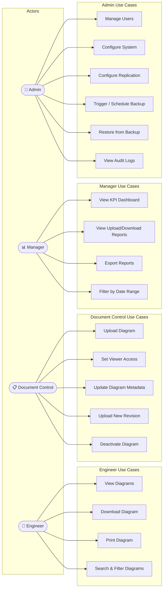
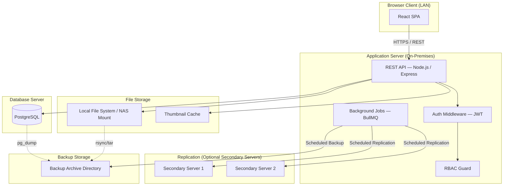
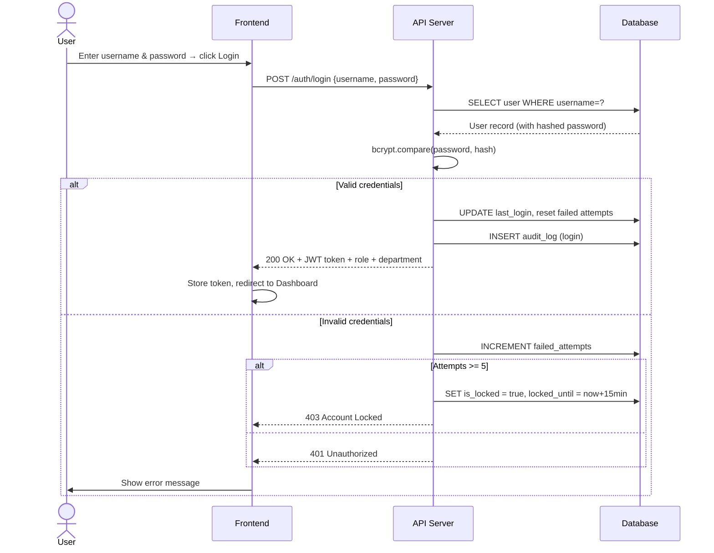
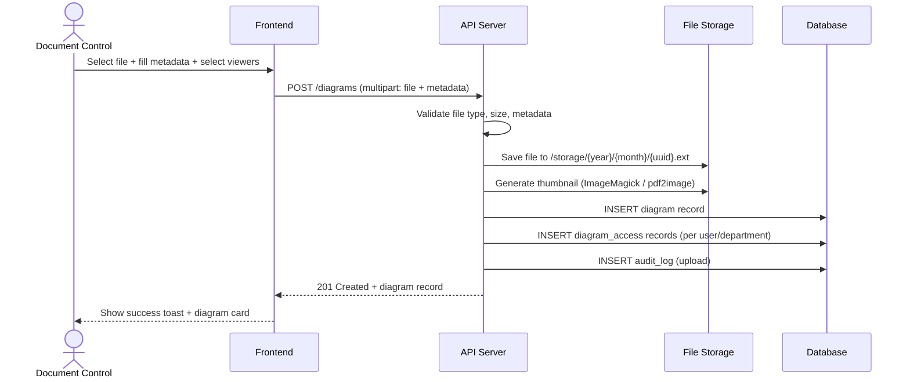
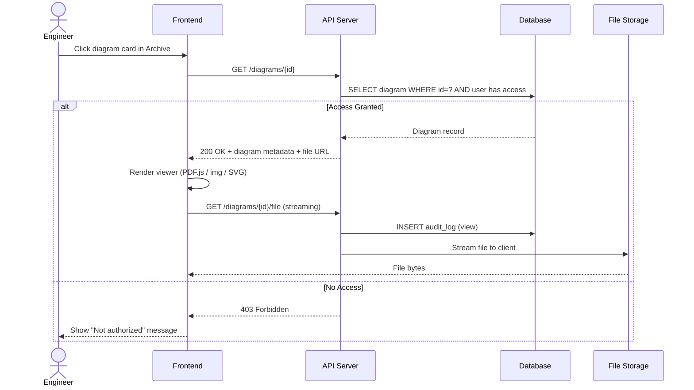
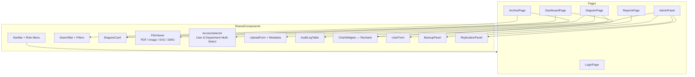
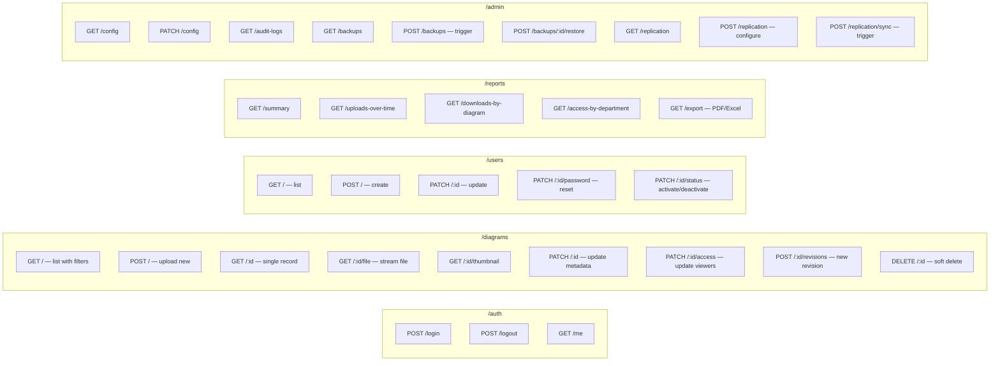
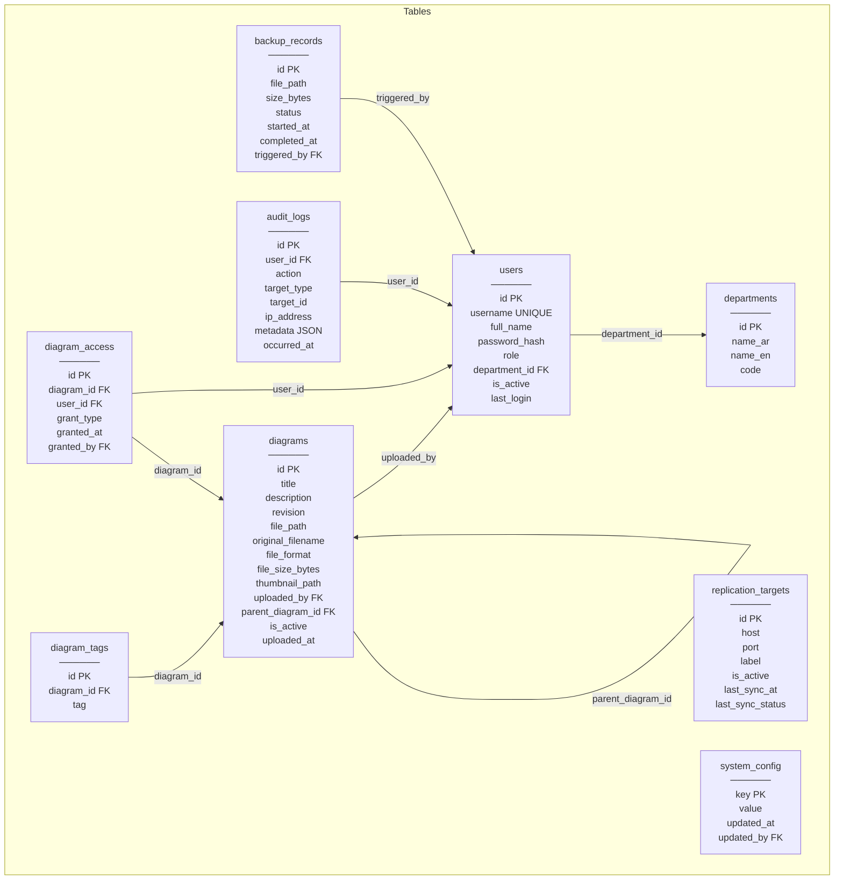

# Diagram Management System — Comprehensive Development Plan

**Project Codename:** DMS (Diagram Management System)
**Version:** 1.0
**Date:** 2026-03-27
**Deployment Model:** On-Premises (fully air-gapped capable)

---

## Table of Contents

1. [Software Requirements Specification (SRS)](#1-software-requirements-specification)
2. [System Design Models (Mermaid)](#2-system-design-models)
3. [Technology Stack Recommendation](#3-technology-stack)
4. [Task Breakdown & AI Agent Prompts](#4-task-breakdown--ai-agent-prompts)

---

# 1. Software Requirements Specification

## 1.1 Introduction

### 1.1.1 Purpose
This document specifies the requirements for the Diagram Management System (DMS), a fully on-premises web application that enables structured archiving, controlled distribution, and access management of engineering diagrams across a multi-department organization.

### 1.1.2 Scope
The DMS provides:
- Secure, role-based diagram repository
- Department-targeted diagram distribution
- Format-agnostic archival (PDF, JPEG, PNG, SVG, DWG)
- Administrative oversight and data governance
- Statistics and reporting dashboard
- Full on-premises deployment with no external dependencies

### 1.1.3 Definitions & Acronyms

| Term | Definition |
|------|-----------|
| DC | Document Control — responsible for uploading and distributing approved diagrams |
| DWG | AutoCAD native drawing format |
| SRS | Software Requirements Specification |
| RBAC | Role-Based Access Control |
| On-Premises | Deployed and operated entirely within the organization's own infrastructure |

### 1.1.4 System Users Overview

| Role | Arabic | Count Estimate |
|------|--------|----------------|
| Engineer | مهندس | Many (per department) |
| Document Control | مراقب الوثائق | Few |
| Manager | مدير | Few |
| Admin | مسؤول النظام | 1–2 |

---

## 1.2 Overall Description

### 1.2.1 User Classes and Characteristics

#### Engineer
- Belongs to exactly **one** of the following departments:
  - الري (Irrigation)
  - الصيانة (Maintenance)
  - التسليم (Delivery/Handover)
  - المكتب الفني (Technical Office)
  - الإنشاءات (Construction)
- Can **view** diagrams assigned to them
- Can **download** diagrams
- Can **print** diagrams (browser print or server-rendered PDF)
- Cannot upload, edit metadata, or manage users

#### Document Control (DC)
- Uploads approved diagrams in any supported format
- Sets metadata (title, description, revision number, tags, department, date)
- Selects **viewers** individually (by engineer name) or **by entire department**
- Manages diagram versions and revisions
- Cannot access system configuration or user management

#### Manager
- Views dashboards with statistics and reports
- Views aggregated upload activity, download frequency, per-department access metrics
- Cannot upload diagrams or manage users

#### Admin
- Full system configuration (storage paths, LDAP/AD integration if applicable, branding)
- User management (create, update, deactivate, assign roles and departments)
- Data replication configuration (sync to secondary/tertiary on-prem servers)
- Backup and restore operations (scheduled and manual)
- Audit log viewer

---

### 1.2.2 Supported File Formats

| Format | MIME Type | Notes |
|--------|-----------|-------|
| PDF | application/pdf | Preview via PDF.js |
| JPEG | image/jpeg | Direct browser preview |
| PNG | image/png | Direct browser preview |
| SVG | image/svg+xml | Direct browser preview |
| DWG | application/acad | No browser preview; download-only with thumbnail on upload |

---

## 1.3 Functional Requirements

### FR-01: Authentication & Session Management
- FR-01.1: The system shall provide a login page with username and password fields.
- FR-01.2: Passwords shall be hashed using bcrypt (minimum cost factor 12).
- FR-01.3: Sessions shall expire after a configurable idle period (default: 30 minutes).
- FR-01.4: Failed login attempts exceeding 5 shall lock the account for a configurable duration.
- FR-01.5: The system shall support optional LDAP/Active Directory integration for authentication.
- FR-01.6: Role and department shall be embedded in the session token (JWT or server session).

### FR-02: Engineer — Diagram Access
- FR-02.1: Engineers shall see only diagrams explicitly shared with them or their department.
- FR-02.2: Engineers shall be able to view diagrams in-browser for supported formats (PDF, JPEG, PNG, SVG).
- FR-02.3: Engineers shall be able to download any diagram accessible to them.
- FR-02.4: Engineers shall be able to trigger a print dialog for any diagram.
- FR-02.5: DWG files shall display a static thumbnail or placeholder with a download button only.
- FR-02.6: Engineers shall be able to search and filter their accessible diagrams by title, date, tag, and revision.

### FR-03: Document Control — Upload & Distribution
- FR-03.1: DC shall be able to upload one or more diagram files per session.
- FR-03.2: Maximum file size per upload shall be configurable (default: 200 MB).
- FR-03.3: DC shall fill in metadata for each uploaded diagram:
  - Title (required)
  - Description (optional)
  - Revision number (required, e.g., "Rev A", "Rev 2")
  - Tags (optional, comma-separated)
  - Upload date (auto-populated, editable)
- FR-03.4: DC shall select viewers using one or both of:
  - Individual engineer selection (searchable multi-select)
  - Department-level selection (check all engineers in a department)
- FR-03.5: DC shall be able to update the viewer list after upload.
- FR-03.6: DC shall be able to upload a new revision of an existing diagram, linking it to the diagram's history.
- FR-03.7: DC shall be able to deactivate (soft-delete) a diagram, hiding it from all engineers.

### FR-04: Manager — Reports & Statistics
- FR-04.1: The manager dashboard shall display:
  - Total diagrams in the system (active / archived)
  - Number of uploads per week/month (chart)
  - Top diagrams by download count
  - Per-department access summary
  - Active users over time
- FR-04.2: Reports shall be exportable as PDF or Excel.
- FR-04.3: Date range filters shall be available on all charts.

### FR-05: Admin — User Management
- FR-05.1: Admin shall create user accounts with: username, full name, email (optional), role, department (if Engineer), password (or LDAP binding).
- FR-05.2: Admin shall edit user details and reset passwords.
- FR-05.3: Admin shall activate or deactivate accounts.
- FR-05.4: Admin shall view and search the full user list.

### FR-06: Admin — System Configuration
- FR-06.1: Admin shall configure file storage root path.
- FR-06.2: Admin shall configure maximum upload file size.
- FR-06.3: Admin shall configure session timeout duration.
- FR-06.4: Admin shall configure LDAP server connection (host, port, bind DN, base DN).

### FR-07: Admin — Data Replication
- FR-07.1: Admin shall configure one or more secondary server targets (IP/hostname, port, credentials).
- FR-07.2: The system shall support scheduled replication (configurable interval: hourly/daily).
- FR-07.3: Admin shall trigger manual replication on demand.
- FR-07.4: Replication status (last sync time, success/failure, bytes transferred) shall be displayed.
- FR-07.5: Replication shall cover both files and database records.

### FR-08: Admin — Backup & Restore
- FR-08.1: Admin shall configure automated backup schedule (daily/weekly).
- FR-08.2: Admin shall trigger a manual backup on demand.
- FR-08.3: Backups shall include both the file store and database dump.
- FR-08.4: Admin shall list available backups with size and timestamp.
- FR-08.5: Admin shall restore the system from a selected backup (with confirmation dialog).

### FR-09: Audit Logging
- FR-09.1: The system shall log all significant events: login, logout, upload, download, print, user created/modified, role change, backup, restore, replication.
- FR-09.2: Logs shall include: timestamp, user, action, target resource, IP address.
- FR-09.3: Admin shall view and search audit logs with date and user filters.

---

## 1.4 Non-Functional Requirements

| ID | Category | Requirement |
|----|----------|-------------|
| NFR-01 | Performance | Page load time < 2s on LAN; diagram list renders < 1s |
| NFR-02 | Scalability | Support up to 500 concurrent users and 100,000 diagram records |
| NFR-03 | Security | All traffic over HTTPS (self-signed cert supported for on-prem); RBAC enforced on every endpoint |
| NFR-04 | Availability | System shall target 99.5% uptime during working hours |
| NFR-05 | Localization | UI shall support Arabic (RTL) and English; language switchable per user |
| NFR-06 | Portability | Deployable on Linux (Ubuntu 20.04+) and Windows Server 2019+ |
| NFR-07 | Offline | System must be fully functional without any internet access |
| NFR-08 | Storage | File store path shall be configurable; NAS/SAN mounts supported |
| NFR-09 | Browser Support | Chrome, Edge, Firefox (latest 2 major versions) |
| NFR-10 | Accessibility | WCAG 2.1 AA compliance for core workflows |

---

## 1.5 Screen Specifications

### Screen 1: Login Page (صفحة التسجيل)
- Fields: Username, Password
- Actions: Login button, "Forgot password" (Admin-reset flow)
- Branding: Organization logo, system name
- Language toggle (AR / EN)
- Error: Display account-locked message with countdown if applicable

### Screen 2: Dashboard (داشبورد)
- **Engineer:** Recent diagrams shared with me (card grid), quick search bar, notifications (new diagrams available)
- **DC:** Upload statistics (my uploads this month), recent uploads list, quick-upload button
- **Manager:** KPI cards (total diagrams, downloads this week, active users), charts (upload trend, per-department breakdown), date range selector
- **Admin:** System health cards (storage usage, active sessions, replication status, last backup), quick links to sub-sections

### Screen 3: Archive / Diagrams Page (صفحة الأرشيف — اللوحات)
- Search bar (by title, tag, revision)
- Filter panel: department, file type, date range, uploader
- Results grid (card view) or table view (toggle)
- Each card: thumbnail, title, revision, file type badge, upload date, download button
- Pagination / infinite scroll
- DC users see additional "Manage" button per card

### Screen 4: Diagram Page (صفحة اللوحة)
- Header: Title, revision badge, file type, upload date, uploader name
- Viewer area:
  - PDF/JPEG/PNG/SVG: inline viewer (PDF.js for PDF, `` for raster, inline SVG)
  - DWG: placeholder icon with "CAD File — Download to View" message
- Action bar: Download button, Print button (opens print dialog or triggers server PDF render)
- Sidebar (DC/Admin only): Viewer list (who has access), edit metadata, upload new revision, deactivate
- Revision history panel: list of all revisions with links

---

# 2. System Design Models

## 2.1 Entity-Relationship Diagram



---

## 2.2 Use Case Diagram



---

## 2.3 System Architecture Diagram



---

## 2.4 Sequence Diagrams

### 2.4.1 Login Flow



---

### 2.4.2 DC Uploads and Assigns Diagram



---

### 2.4.3 Engineer Views a Diagram



---

## 2.5 Component Diagram (Frontend)



---

## 2.6 API Route Map



---

## 2.7 Database Schema Diagram



---

## 2.8 Deployment Diagram

```mermaid
flowchart TB
    subgraph PrimaryServer["Primary Application Server (On-Premises)"]
        direction TB
        NGINX[NGINX — Reverse Proxy + HTTPS]
        APP[Node.js App — Port 3000]
        PG_PRIMARY[(PostgreSQL Primary)]
        FILES[/var/dms/files]
        BACKUPS[/var/dms/backups]

        NGINX --> APP
        APP --> PG_PRIMARY
        APP --> FILES
        APP --> BACKUPS
    end

    subgraph SecondaryServer["Secondary Server (Replication Target)"]
        PG_REPLICA[(PostgreSQL Replica)]
        FILES2[/var/dms/files — Replicated]
    end

    subgraph ClientMachines["Client Machines (LAN)"]
        BROWSER1[Engineer Browser]
        BROWSER2[DC Browser]
        BROWSER3[Manager Browser]
        BROWSER4[Admin Browser]
    end

    BROWSER1 & BROWSER2 & BROWSER3 & BROWSER4 -- HTTPS LAN --> NGINX
    APP -- rsync + pg_dump --> SecondaryServer
```

---

# 3. Technology Stack

| Layer | Technology | Rationale |
|-------|-----------|-----------|
| Frontend | React 18 + TypeScript | Component-based, large ecosystem, RTL support |
| Styling | Tailwind CSS + shadcn/ui | Rapid, consistent UI; RTL via `dir="rtl"` |
| PDF Viewer | PDF.js | Fully offline, no CDN needed |
| State Management | Zustand | Lightweight, no boilerplate |
| API Client | Axios + React Query | Caching, retries, loading states |
| Backend | Node.js + Express + TypeScript | Unified JS stack, strong file-handling |
| ORM | Prisma | Type-safe DB access, migrations |
| Database | PostgreSQL 15 | Robust, FOSS, full-text search |
| File Processing | Sharp (images), pdf-thumbnail | Thumbnail generation |
| DWG Preview | LibreCAD CLI (optional) | Convert DWG to PNG for thumbnails |
| Auth | JWT (short-lived) + Refresh tokens | Stateless; session stored in httpOnly cookie |
| Background Jobs | BullMQ + Redis | Replication, backup, thumbnail generation queues |
| Reverse Proxy | NGINX | SSL termination, static file serving |
| Backup | pg_dump + tar + cron | Simple, reliable, scriptable |
| Replication | rsync (files) + pg_basebackup or logical replication | On-prem, no cloud dependency |
| Containerization | Docker + Docker Compose | Reproducible deployment |
| OS Target | Ubuntu 22.04 LTS / Windows Server 2019 | Docker covers both |

---

# 4. Task Breakdown & AI Agent Prompts

Each task below is a self-contained development unit. Paste the prompt directly into an AI coding agent (e.g., Claude Code, Cursor, Copilot Workspace).

---

## PHASE 1: Project Scaffold & Infrastructure

---

### TASK-001 — Project Monorepo Setup

**Priority:** P0 | **Estimate:** 2h

**Prompt:**
```
Create a Node.js monorepo with the following structure using npm workspaces:

/
├── packages/
│   ├── backend/          # Express + TypeScript API
│   └── frontend/         # React + TypeScript + Vite SPA
├── docker-compose.yml
├── .env.example
└── README.md

Requirements:
- backend: Node.js 20, Express 4, TypeScript 5, Prisma 5, BullMQ, Redis client, Sharp, Axios, jsonwebtoken, bcrypt, multer, cors, helmet
- frontend: React 18, TypeScript 5, Vite 5, Tailwind CSS 3, shadcn/ui, React Query v5, Zustand, Axios, React Router v6, PDF.js (pdfjs-dist)
- docker-compose.yml should define services: postgres (v15), redis (v7), backend, frontend (served via NGINX in prod)
- Add .env.example with: DATABASE_URL, JWT_SECRET, JWT_REFRESH_SECRET, REDIS_URL, FILE_STORAGE_PATH, BACKUP_PATH, PORT, FRONTEND_URL
- Add a root-level Makefile with targets: dev, build, migrate, seed, docker-up, docker-down
- Configure ESLint + Prettier for both packages
- TypeScript strict mode enabled in both packages
```

---

### TASK-002 — Database Schema & Migrations

**Priority:** P0 | **Estimate:** 3h

**Prompt:**
```
In packages/backend, create a complete Prisma schema at prisma/schema.prisma with the following models:

1. User: id, username (unique), fullName, email (optional), passwordHash, role (enum: ENGINEER, DC, MANAGER, ADMIN), departmentId (optional FK), isActive (default true), failedLoginAttempts (default 0), lockedUntil (optional DateTime), lastLogin (optional DateTime), createdAt, updatedAt

2. Department: id, nameAr, nameEn, code (unique), createdAt

3. Diagram: id, title, description (optional), revision, filePath, originalFilename, fileFormat (enum: PDF, JPEG, PNG, SVG, DWG), fileSizeBytes (BigInt), thumbnailPath (optional), uploadedById (FK User), parentDiagramId (optional self-relation FK), isActive (default true), uploadedAt, updatedAt

4. DiagramTag: id, diagramId (FK), tag

5. DiagramAccess: id, diagramId (FK), userId (FK), grantType (enum: INDIVIDUAL, DEPARTMENT), grantedAt, grantedById (FK User)

6. AuditLog: id, userId (optional FK), action (string), targetType (optional string), targetId (optional string), ipAddress (optional string), metadata (Json optional), occurredAt

7. BackupRecord: id, filePath, sizeBytes (BigInt), status (enum: RUNNING, SUCCESS, FAILED), startedAt, completedAt (optional), triggeredById (optional FK User)

8. ReplicationTarget: id, host, port (default 5432), label, credentials (Json), isActive (default true), lastSyncAt (optional), lastSyncStatus (enum: SUCCESS, FAILED, NEVER, default NEVER), createdAt

9. SystemConfig: key (PK String), value (String), updatedAt, updatedById (optional FK User)

After defining the schema:
- Generate and run initial migration: npx prisma migrate dev --name init
- Create a seed file at prisma/seed.ts that:
  - Seeds 5 departments (الري, الصيانة, التسليم, المكتب الفني, الإنشاءات) with English equivalents (Irrigation, Maintenance, Delivery, Technical Office, Construction)
  - Creates one Admin user: username=admin, password=Admin@123 (hashed)
  - Creates one DC user, one Manager, and one Engineer per department
  - Inserts default system config entries: max_upload_size_mb=200, session_timeout_minutes=30
- Run seed: npx prisma db seed
```

---

### TASK-003 — NGINX + Docker Compose Production Config

**Priority:** P0 | **Estimate:** 2h

**Prompt:**
```
Create a production-ready Docker Compose and NGINX configuration for fully on-premises deployment.

docker-compose.yml services:
1. postgres: image postgres:15-alpine, named volume, healthcheck
2. redis: image redis:7-alpine, named volume, healthcheck
3. backend: build from packages/backend, depends_on postgres+redis (healthy), env_file .env, volumes for FILE_STORAGE_PATH and BACKUP_PATH
4. frontend: build from packages/frontend, NGINX serving the built React app + proxying /api to backend

nginx/nginx.conf:
- Serve frontend static files from /usr/share/nginx/html
- Proxy /api/* to http://backend:3000/api
- Proxy /files/* to http://backend:3000/files (for file streaming)
- Enable gzip compression
- Set client_max_body_size to 500m (large file uploads)
- Add security headers: X-Frame-Options, X-Content-Type-Options, X-XSS-Protection
- Configure for HTTPS with self-signed cert at /etc/nginx/certs/dms.crt and dms.key
- Add a script generate-cert.sh that creates a self-signed cert for the server hostname

Also create:
- packages/backend/Dockerfile (multi-stage: build → production)
- packages/frontend/Dockerfile (build stage with Vite → NGINX stage)
- .dockerignore files for both packages
```

---

## PHASE 2: Backend — Authentication & Core API

---

### TASK-004 — Auth Middleware & JWT Utilities

**Priority:** P0 | **Estimate:** 3h

**Prompt:**
```
In packages/backend, implement a complete authentication system:

1. src/utils/auth.ts:
   - generateAccessToken(user): JWT signed with JWT_SECRET, payload: {sub: userId, role, departmentId}, expires in 15 minutes
   - generateRefreshToken(user): JWT signed with JWT_REFRESH_SECRET, expires in 7 days
   - verifyAccessToken(token): returns decoded payload or throws
   - hashPassword(plain): bcrypt hash with cost factor 12
   - comparePassword(plain, hash): bcrypt compare

2. src/middleware/authenticate.ts:
   - Express middleware that reads JWT from Authorization: Bearer header OR httpOnly cookie named 'accessToken'
   - Attaches req.user = {id, role, departmentId} if valid
   - Returns 401 if missing/invalid/expired

3. src/middleware/authorize.ts:
   - authorize(...roles: Role[]): Express middleware that checks req.user.role against allowed roles
   - Returns 403 if unauthorized

4. src/routes/auth.ts — POST /api/auth/login:
   - Validate body: username (string, required), password (string, required)
   - Find user by username, check isActive and lockedUntil
   - Compare password, handle failed attempts (lock after 5 attempts for 15 minutes)
   - On success: reset failed attempts, update lastLogin, create AuditLog
   - Return: {accessToken, user: {id, username, fullName, role, departmentId}}
   - Set refreshToken as httpOnly cookie

5. src/routes/auth.ts — POST /api/auth/logout:
   - Clear refreshToken cookie
   - Create AuditLog entry
   - Return 200

6. src/routes/auth.ts — GET /api/auth/me:
   - Requires authenticate middleware
   - Return current user record (without passwordHash)

7. src/routes/auth.ts — POST /api/auth/refresh:
   - Reads refreshToken from cookie
   - Verifies it, generates new accessToken
   - Returns new accessToken

Use Zod for all request body validation. Create src/utils/auditLog.ts helper: logAction(prisma, {userId, action, targetType, targetId, ipAddress, metadata}).
```

---

### TASK-005 — File Upload & Diagram API

**Priority:** P0 | **Estimate:** 5h

**Prompt:**
```
In packages/backend, implement the complete Diagrams API:

File handling setup (src/utils/storage.ts):
- Configure multer with diskStorage, destination: process.env.FILE_STORAGE_PATH/{year}/{month}/
- Filename: {uuid}{ext} preserving original extension
- File filter: allow only .pdf, .jpg, .jpeg, .png, .svg, .dwg (reject others with 400)
- Max file size from SystemConfig (read from DB or env fallback: 200MB)

Thumbnail generation (src/utils/thumbnail.ts):
- generateThumbnail(filePath, fileFormat, outputPath): Promise<string|null>
  - PDF: use pdf2pic or pdftocairo to extract page 1 as JPEG, then resize to 400x300 with Sharp
  - JPEG/PNG: use Sharp to resize to 400x300, output JPEG
  - SVG: convert to PNG with Sharp (Sharp supports SVG), then resize
  - DWG: return null (no thumbnail)
- Store thumbnails in {FILE_STORAGE_PATH}/thumbs/{uuid}.jpg

Routes (src/routes/diagrams.ts):

POST /api/diagrams (DC only):
  - multer single upload
  - Body (multipart): title, description, revision, tags (comma-separated), viewerIds (JSON array of user IDs), viewerDepartmentIds (JSON array of department IDs)
  - Validate all required fields with Zod
  - Save file, generate thumbnail async
  - Insert Diagram record, DiagramAccess records, DiagramTag records
  - Log audit event
  - Return 201 + diagram record with access list

GET /api/diagrams (authenticated):
  - Engineers: only return diagrams in diagram_access for their userId
  - DC/Admin: return all diagrams
  - Manager: return all diagrams (read-only)
  - Query params: search (title/tag fulltext), fileFormat, uploadedFrom, uploadedTo, page (default 1), limit (default 20)
  - Return: { data: Diagram[], total, page, limit }

GET /api/diagrams/:id (authenticated, access-checked for engineers):
  - Return full diagram record + tags + access list (for DC/Admin) + revision history

GET /api/diagrams/:id/file (authenticated, access-checked):
  - Stream file with correct Content-Type header
  - Support Range header for partial content (important for PDF viewer)
  - Log download/view audit event

GET /api/diagrams/:id/thumbnail (authenticated, access-checked):
  - Stream thumbnail JPEG or return 404 if not generated

PATCH /api/diagrams/:id (DC only):
  - Update title, description, revision, tags

PATCH /api/diagrams/:id/access (DC only):
  - Replace viewer list: accepts { viewerIds: number[], viewerDepartmentIds: number[] }
  - Delete old diagram_access records, insert new ones

POST /api/diagrams/:id/revisions (DC only):
  - Same as POST /api/diagrams but sets parentDiagramId = :id
  - Return new revision record

DELETE /api/diagrams/:id (DC/Admin):
  - Soft delete: set isActive = false
  - Log audit event
```

---

### TASK-006 — Users & Departments API

**Priority:** P1 | **Estimate:** 3h

**Prompt:**
```
In packages/backend, implement the Users and Departments API:

GET /api/departments (authenticated):
  - Return all departments: [{id, nameAr, nameEn, code}]

GET /api/users (Admin only):
  - Query params: role, departmentId, isActive, search (fullName/username), page, limit
  - Return paginated list with department info joined

POST /api/users (Admin only):
  - Body: username, fullName, email (optional), role (ENGINEER|DC|MANAGER|ADMIN), departmentId (required if role=ENGINEER), password
  - Validate: username unique, departmentId exists if provided, role is valid enum
  - Hash password before storing
  - Log audit event
  - Return 201 + created user (no passwordHash)

PATCH /api/users/:id (Admin only):
  - Updatable fields: fullName, email, role, departmentId, isActive
  - Cannot change own role (prevent self-lockout)
  - Log audit event

PATCH /api/users/:id/password (Admin only):
  - Body: newPassword (min 8 chars, Zod validation)
  - Hash and update
  - Log audit event

GET /api/users/engineers (DC only):
  - Returns list of all active engineers with their department info
  - Used by DC to populate the viewer selector when uploading

Use Zod schemas for all input validation. All routes require authenticate middleware + appropriate authorize middleware.
```

---

### TASK-007 — Reports API

**Priority:** P1 | **Estimate:** 3h

**Prompt:**
```
In packages/backend, implement the Reports API (Manager + Admin access):

All routes under /api/reports, require authenticate + authorize(MANAGER, ADMIN).
All routes accept optional query params: from (ISO date), to (ISO date).

GET /api/reports/summary:
  - Return:
    {
      totalDiagrams: number,         // active diagrams
      totalArchivedDiagrams: number, // inactive
      uploadsThisMonth: number,
      downloadsThisMonth: number,    // from audit_logs WHERE action='DOWNLOAD'
      activeUsersThisMonth: number,  // distinct users in audit_logs this month
      storageUsedBytes: bigint       // sum of fileSizeBytes
    }

GET /api/reports/uploads-over-time:
  - Query param: granularity (day|week|month, default: month)
  - Return: [{period: string, count: number}] — counts of uploads grouped by period

GET /api/reports/downloads-by-diagram:
  - Return top 20 diagrams by download count: [{diagramId, title, revision, downloadCount}]

GET /api/reports/access-by-department:
  - Return: [{departmentId, nameAr, nameEn, diagramCount, downloadCount}]

GET /api/reports/export:
  - Query param: format (pdf|excel)
  - Generate a report document:
    - Excel: use ExcelJS to create a workbook with 4 sheets (Summary, Uploads Over Time, Top Downloads, Department Breakdown)
    - PDF: use PDFKit to generate a structured report with tables and a header
  - Stream the file with appropriate Content-Disposition header

All queries should use Prisma's groupBy and raw SQL where necessary for performance. Include proper TypeScript types for all response shapes.
```

---

### TASK-008 — Admin API (Config, Backup, Replication, Audit)

**Priority:** P1 | **Estimate:** 5h

**Prompt:**
```
In packages/backend, implement the Admin API (Admin role only):

--- System Config ---
GET /api/admin/config: Return all SystemConfig records as {key: value} object
PATCH /api/admin/config: Body is {key: value} pairs. Upsert into SystemConfig. Log audit event.

--- Audit Logs ---
GET /api/admin/audit-logs:
  Query params: userId, action, from, to, page, limit (default 50)
  Return paginated AuditLog records with user.username joined

--- Backup ---
POST /api/admin/backups (trigger manual backup):
  - Create BackupRecord with status RUNNING
  - Add to BullMQ queue 'backup'
  - Return 202 + {jobId, backupRecordId}

GET /api/admin/backups:
  - Return all BackupRecord entries ordered by startedAt DESC

POST /api/admin/backups/:id/restore:
  - Queue a restore job
  - IMPORTANT: Require a confirmation token (body: {confirmToken: 'RESTORE'}) before proceeding
  - Return 202 Accepted

--- Replication ---
GET /api/admin/replication: Return all ReplicationTarget records
POST /api/admin/replication: Create new ReplicationTarget. Body: {host, port, label, credentials: {username, password}}
PATCH /api/admin/replication/:id: Update target config
DELETE /api/admin/replication/:id: Remove target
POST /api/admin/replication/:id/sync: Trigger immediate sync for a specific target, add to BullMQ 'replication' queue

--- BullMQ Workers ---
Create src/workers/backup.worker.ts:
  - Process 'backup' queue
  - Run: pg_dump DATABASE_URL > {BACKUP_PATH}/{timestamp}.sql
  - Tar the FILE_STORAGE_PATH into {BACKUP_PATH}/{timestamp}-files.tar.gz
  - Update BackupRecord status to SUCCESS or FAILED
  - Calculate and store sizeBytes

Create src/workers/replication.worker.ts:
  - Process 'replication' queue with {targetId}
  - Load ReplicationTarget from DB
  - rsync FILE_STORAGE_PATH to target host via SSH (use node-ssh or child_process)
  - pg_dump and scp the SQL file to target
  - Update lastSyncAt and lastSyncStatus

Create src/workers/thumbnail.worker.ts:
  - Process 'thumbnail' queue
  - Run thumbnail generation for newly uploaded files
  - Update diagram.thumbnailPath on completion

Initialize all workers in src/workers/index.ts. Start workers from main app entry point.
```

---

## PHASE 3: Frontend — Core UI

---

### TASK-009 — Frontend Scaffold, Routing & Auth State

**Priority:** P0 | **Estimate:** 3h

**Prompt:**
```
In packages/frontend, set up the complete application shell:

1. Configure Tailwind CSS with RTL support:
   - Install tailwindcss-rtl plugin
   - Create tailwind.config.ts with custom colors: primary (#1E40AF), secondary (#64748B), accent (#F59E0B)
   - Set up CSS variables in index.css

2. Create src/store/authStore.ts (Zustand):
   - State: user (null | {id, username, fullName, role, departmentId}), accessToken (string|null), isLoading
   - Actions: login(credentials), logout(), setUser, refreshToken
   - Persist user to localStorage (not token)

3. Create src/api/client.ts (Axios):
   - Base URL: /api
   - Request interceptor: attach Authorization: Bearer {accessToken} from store
   - Response interceptor: on 401, attempt token refresh via POST /auth/refresh, retry original request; on second 401, call logout()

4. Create src/routes/AppRouter.tsx:
   - Use React Router v6 createBrowserRouter
   - Route structure:
     / → redirect to /dashboard
     /login → LoginPage (public only, redirect if authed)
     /dashboard → DashboardPage (protected)
     /archive → ArchivePage (protected: ENGINEER, DC, ADMIN)
     /diagrams/:id → DiagramPage (protected: ENGINEER, DC, ADMIN)
     /reports → ReportsPage (protected: MANAGER, ADMIN)
     /admin → AdminPanel (protected: ADMIN only)
     /admin/users → AdminUsersPage (ADMIN)
     /admin/config → AdminConfigPage (ADMIN)
     /admin/backups → AdminBackupsPage (ADMIN)
     /admin/replication → AdminReplicationPage (ADMIN)
     /admin/audit → AdminAuditPage (ADMIN)
     * → NotFoundPage

5. Create ProtectedRoute component:
   - Checks auth state and role
   - Redirects to /login if unauthenticated
   - Shows 403 page if wrong role

6. Create src/components/layout/AppShell.tsx:
   - Top navigation bar with: logo/system name, current user name + role badge, language toggle (AR/EN), logout button
   - Sidebar navigation (role-based menu items)
   - Main content area
   - Support RTL/LTR toggle via `dir` attribute on `<html>` using i18next

7. Set up i18next with two namespaces: ar.json and en.json. Add translations for all navigation labels, button labels, and common UI strings. Default language: Arabic (RTL).
```

---

### TASK-010 — Login Page

**Priority:** P0 | **Estimate:** 2h

**Prompt:**
```
In packages/frontend, create src/pages/LoginPage.tsx:

Design requirements:
- Full-height centered card layout
- Organization logo placeholder (img src from /logo.png with fallback SVG icon)
- System name: "نظام إدارة اللوحات الهندسية" (Engineering Diagram Management System)
- Username input with label "اسم المستخدم"
- Password input with label "كلمة المرور" and show/hide toggle
- Login button: full-width, primary color, with loading spinner during request
- Error message area: shows API error (invalid credentials, account locked with remaining time)
- Language toggle button (AR/EN) in top-right corner
- RTL layout by default

Behavior:
- On submit: call authStore.login({username, password})
- If login successful: navigate to /dashboard
- If account locked: show lock icon + "الحساب محظور لمدة X دقيقة" message
- Keyboard: Enter submits the form
- Disable submit button while loading or if fields empty

Use React Hook Form + Zod for validation:
- username: required, min 3 chars
- password: required, min 6 chars

Styling: Use Tailwind CSS + shadcn/ui Card, Input, Button, Alert components. Make it visually polished with subtle gradient background.
```

---

### TASK-011 — Dashboard Pages (All Roles)

**Priority:** P1 | **Estimate:** 5h

**Prompt:**
```
In packages/frontend, create role-based dashboard pages:

Create src/pages/dashboard/EngineerDashboard.tsx:
- "مرحباً {fullName}" greeting with current date in Arabic
- "اللوحات الجديدة" section: grid of DiagramCard components for diagrams shared in last 7 days
- Quick search bar that navigates to /archive?search=...
- Empty state illustration if no new diagrams

Create src/pages/dashboard/DCDashboard.tsx:
- Stats row: "رفعت هذا الشهر" (uploads this month), "إجمالي اللوحات" (total diagrams)
- Quick upload button → opens UploadDiagramModal
- Recent uploads table: thumbnail, title, revision, upload date, viewers count, status badge

Create src/pages/dashboard/ManagerDashboard.tsx:
- 4 KPI cards: Total Diagrams, Downloads This Month, Active Users, Storage Used
- Line chart (Recharts): Uploads over last 6 months
- Bar chart (Recharts): Downloads per department
- Date range picker (from/to) that refreshes all charts
- Export button (PDF/Excel) calling GET /api/reports/export

Create src/pages/dashboard/AdminDashboard.tsx:
- System health cards: Storage Used (with progress bar), Active Sessions, Last Backup (time ago + status badge), Replication Status per target
- Quick action buttons: Trigger Backup, Add User, View Audit Logs
- Recent audit log table (last 10 entries)

Create src/pages/DashboardPage.tsx:
- Reads role from authStore
- Renders the appropriate dashboard component for the role
- Wraps all in the AppShell layout

All API calls use React Query (useQuery). Loading states use skeleton components. Error states use retry buttons.
```

---

### TASK-012 — Archive Page & Diagram Cards

**Priority:** P0 | **Estimate:** 4h

**Prompt:**
```
In packages/frontend, create the Archive page:

Create src/components/diagrams/DiagramCard.tsx:
- Props: {diagram: DiagramSummary, onOpen: () => void}
- Shows: thumbnail (or format icon placeholder for DWG/missing thumbs), title, revision badge, file format badge with color coding (PDF=red, DWG=blue, SVG=green, PNG/JPEG=gray), upload date formatted in Arabic, file size formatted (KB/MB)
- Hover state: slight shadow elevation
- Download button (icon only) on hover
- For DC/Admin: gear icon showing quick actions (Edit, Manage Access, Deactivate)

Create src/components/diagrams/DiagramFilters.tsx:
- Collapsible filter panel (open by default on desktop, collapsed on mobile)
- File format checkboxes (PDF, JPEG, PNG, SVG, DWG)
- Date range picker (from/to)
- Department filter (multi-select, DC/Admin only)
- Clear filters button

Create src/pages/ArchivePage.tsx:
- Search bar at top (debounced 300ms, syncs to URL query param ?search=)
- Filter panel on left sidebar (desktop) or drawer (mobile)
- View toggle: grid (default) or list/table
- Results: infinite scroll OR pagination (10/20/50 per page selector)
- Results count: "يتم عرض X من Y لوحة"
- Empty state with illustration + "لا توجد لوحات متاحة" text
- Loading state: skeleton card grid (12 placeholder cards)
- Error state: retry button
- Clicking a card navigates to /diagrams/:id

Data: useQuery(['diagrams', filters], () => api.get('/diagrams', {params: filters}))
Filters are synced to URL query params using useSearchParams.

For DC users, show floating action button (FAB) "+ رفع لوحة جديدة" that opens UploadDiagramModal.
```

---

### TASK-013 — Diagram Page (Viewer)

**Priority:** P0 | **Estimate:** 5h

**Prompt:**
```
In packages/frontend, create the Diagram detail/viewer page at src/pages/DiagramPage.tsx:

Header section:
- Back button (← رجوع)
- Title (h1), revision badge, file format badge, upload date, uploader name
- Action bar: Download button (calls /api/diagrams/:id/file with content-disposition: attachment), Print button

FileViewer component (src/components/diagrams/FileViewer.tsx):
- PDF: Use PDF.js (pdfjs-dist). Load via /api/diagrams/:id/file URL. Show page navigation controls (prev/next page, page X of Y). Zoom controls (+/-/fit). Loading spinner. Error state.
- JPEG/PNG:  tag with src pointing to /api/diagrams/:id/file. Show with object-fit: contain. Support click-to-zoom overlay.
- SVG: Fetch the SVG text via Axios, sanitize with DOMPurify, render as dangerouslySetInnerHTML in a div. Scale to container.
- DWG: Show a styled placeholder: CAD icon + "ملف AutoCAD — يتطلب برنامج متخصص للعرض" + Download button. Gray background with dashed border.

Sidebar (DC and Admin only — collapsible):
- "المشاهدون" section: list of users with access (avatar initials, name, department badge). "تعديل الوصول" button opens AccessSelectorModal.
- "التعديل" section: Edit metadata form (title, description, revision, tags) with Save button.
- "المراجعات" section: List of all revisions (current highlighted). Click on old revision navigates to that diagram's page.
- "إلغاء التفعيل" button: red, requires confirmation dialog.

Revision history panel (all users):
- Horizontal timeline at bottom (or vertical list) showing all revisions of this diagram family (same parentDiagramId chain). Current revision is highlighted.

Use React Query to fetch diagram data. Refresh after any mutation (edit, access change, deactivate).
```

---

### TASK-014 — Upload Diagram Modal

**Priority:** P1 | **Estimate:** 4h

**Prompt:**
```
In packages/frontend, create src/components/diagrams/UploadDiagramModal.tsx:

This is a multi-step modal/drawer used by Document Control to upload new diagrams.

Step 1 — File Selection:
- Dropzone (react-dropzone) accepting: .pdf, .jpg, .jpeg, .png, .svg, .dwg
- Max file size shown (from system config)
- Shows selected file name, size, and format icon after selection
- "اختر ملفاً أو اسحبه هنا" placeholder text

Step 2 — Metadata:
- Title (required): text input
- Description (optional): textarea
- Revision (required): text input with hint "مثال: Rev A أو Rev 2"
- Tags (optional): tag input component (type tag + Enter to add, × to remove)
- Upload date: date picker (pre-filled with today)

Step 3 — Viewer Access:
- Two-panel layout:
  Left: "الأفراد" (individuals) — searchable list of all engineers, checkbox per user, grouped by department with "تحديد القسم كله" option
  Right: "الأقسام" (departments) — 5 department checkboxes; selecting a department automatically selects all its engineers in the left panel
- Selected viewers count badge: "تم تحديد X مهندس"

Step 4 — Confirmation:
- Summary: file name, title, revision, viewer count
- Upload button with progress bar (using Axios onUploadProgress)
- Cancel button

Navigation: Previous/Next step buttons. Step indicators at top. Validate current step before allowing Next.

On success:
- Close modal
- Invalidate React Query cache for ['diagrams']
- Show success toast: "تم رفع اللوحة بنجاح"

On error:
- Stay on Step 4
- Show error message from API

Also create UploadRevisionModal — same as above but pre-fills the title and parentDiagramId, skips to Step 1 with a note "جاري رفع مراجعة جديدة للوحة: {title}".
```

---

### TASK-015 — Admin Pages

**Priority:** P1 | **Estimate:** 6h

**Prompt:**
```
In packages/frontend, create all Admin sub-pages under src/pages/admin/:

AdminUsersPage.tsx:
- Data table: username, full name, role badge, department, status (active/inactive chip), last login, actions
- Search bar (by name/username), role filter, department filter, status filter
- "إضافة مستخدم" button → opens UserFormModal
- Row actions: Edit (opens UserFormModal pre-filled), Reset Password (opens PasswordResetModal), Activate/Deactivate toggle

UserFormModal.tsx:
- Fields: username, fullName, email, role (select), department (select, shown only if role=ENGINEER), password (for new users, hidden for edit)
- Zod validation, React Hook Form

AdminConfigPage.tsx:
- Form with fields from /api/admin/config:
  - Max Upload Size (MB): number input
  - Session Timeout (minutes): number input
  - LDAP Host, LDAP Port, LDAP Bind DN, LDAP Base DN (collapsible "LDAP Integration" section)
- Save Changes button, undo/reset to saved

AdminBackupsPage.tsx:
- "نسخة احتياطية الآن" trigger button → confirm dialog → POST /api/admin/backups → show toast
- Table of backup records: date, size, status (Running/Success/Failed with icons), duration, Restore button
- Restore flow: click Restore → confirmation dialog with warning text + type "RESTORE" to confirm → POST /api/admin/backups/:id/restore

AdminReplicationPage.tsx:
- List of configured replication targets: label, host:port, last sync time, status badge (Success/Failed/Never), Sync Now button, Edit/Delete buttons
- "إضافة هدف" → form modal: label, host, port, SSH username, SSH password or key path
- Sync status refreshes every 30 seconds (React Query refetchInterval)

AdminAuditPage.tsx:
- Filter bar: user (searchable select), action type (multi-select from fixed list), date range
- Table: timestamp, user, action, target, IP address
- Pagination (50 per page)

AdminLayout.tsx:
- Left sidebar with sub-nav links: Users, Config, Backups, Replication, Audit Logs
- Breadcrumb at top

All API calls use React Query with appropriate invalidations after mutations. All tables use a shared DataTable component built on TanStack Table (already included in shadcn/ui).
```

---

## PHASE 4: Advanced Features & Polish

---

### TASK-016 — Notifications System

**Priority:** P2 | **Estimate:** 3h

**Prompt:**
```
Implement a lightweight in-app notification system for the DMS:

Backend:
1. Add a Notification model to Prisma:
   id, userId (FK), type (enum: NEW_DIAGRAM, NEW_REVISION, SYSTEM), message, isRead, relatedDiagramId (optional FK), createdAt

2. When DC assigns a diagram to users (POST /diagrams or PATCH /diagrams/:id/access), create Notification records for each newly added user

3. GET /api/notifications (authenticated): Return notifications for req.user.id, ordered by createdAt DESC, limit 20, with unread count
4. PATCH /api/notifications/read-all: Mark all as read for user
5. PATCH /api/notifications/:id/read: Mark single notification as read

Frontend:
1. Notification bell icon in NavBar with unread count badge
2. Dropdown popover on click: list of notifications with:
   - Icon (new diagram, new revision)
   - Message text (e.g. "تمت مشاركة لوحة جديدة معك: {title}")
   - Time ago in Arabic (منذ X دقيقة / منذ X ساعة / منذ X يوم)
   - Click navigates to /diagrams/:relatedDiagramId
   - Unread notifications have a highlighted background
3. "تحديد الكل كمقروء" button
4. Polling: useQuery with refetchInterval: 60000 (refresh every minute)
```

---

### TASK-017 — Internationalization (AR/EN) + RTL Support

**Priority:** P1 | **Estimate:** 3h

**Prompt:**
```
Implement complete bilingual (Arabic/English) RTL/LTR support in packages/frontend:

1. Install and configure i18next + react-i18next
2. Create translation files:
   - src/locales/ar.json — Arabic translations for ALL UI strings
   - src/locales/en.json — English translations for ALL UI strings
   Key categories: nav, auth, dashboard, archive, diagram, admin, common, errors

3. Create src/hooks/useLanguage.ts:
   - Reads current language from localStorage (default: 'ar')
   - Provides toggle function
   - On language change: update i18n.language, set document.documentElement.dir ('rtl'|'ltr'), set document.documentElement.lang, update localStorage

4. Replace ALL hardcoded Arabic strings in ALL components with t('key') calls.

5. RTL-specific Tailwind adjustments:
   - Use logical properties: ms- (margin-start), me- (margin-end), ps-, pe- instead of left/right
   - Sidebar should flip to right in RTL
   - Icons that imply direction (arrows, chevrons) should mirror in RTL — use the CSS `transform: scaleX(-1)` utility class or SVG flip

6. Date/number formatting:
   - Create src/utils/format.ts with:
     formatDate(date, lang): returns Arabic or English formatted date
     formatNumber(n, lang): uses Intl.NumberFormat with locale
     formatFileSize(bytes, lang): human-readable (KB, MB, GB) in correct language
     timeAgo(date, lang): relative time in Arabic or English

7. Arabic numerals: When lang='ar', format numbers as Arabic-Indic numerals (٠١٢٣٤٥٦٧٨٩) using Intl.NumberFormat('ar-EG')

8. Test each page in both AR (RTL) and EN (LTR) modes.
```

---

### TASK-018 — DWG Thumbnail Generation via LibreCAD

**Priority:** P2 | **Estimate:** 3h

**Prompt:**
```
In packages/backend, implement optional DWG thumbnail generation using LibreCAD CLI:

1. Create src/utils/dwgThumbnail.ts:
   - Check if librecad or dwg2dxf is installed: exec('which librecad')
   - If available, run: librecad --export-pdf {inputDwg} {tempPdf}
   - Then use existing PDF thumbnail pipeline to extract page 1 as JPEG
   - If LibreCAD not available, log a warning and return null
   - Also check for ODA File Converter (Teigha): which ODAFileConverter
   - If ODA available, use it to convert DWG→PDF first, then to JPEG

2. Update src/utils/thumbnail.ts:
   - In generateThumbnail, for DWG format, call dwgThumbnail.generateDwgThumbnail(filePath)

3. Create a DWG thumbnail queue in BullMQ (separate from the general thumbnail queue) with concurrency 1 (DWG conversion is CPU-intensive)

4. Create a test script at scripts/test-dwg-thumb.ts:
   - Accepts a DWG file path as argument
   - Runs the full thumbnail pipeline
   - Outputs the result path or error
   - Run with: npx ts-node scripts/test-dwg-thumb.ts path/to/file.dwg

5. Update the docker-compose.yml to optionally install LibreCAD in the backend image:
   - Add a build ARG: INSTALL_LIBRECAD (default: false)
   - If true, apt-get install librecad
   - Document this in README.md under "Optional DWG Preview"
```

---

### TASK-019 — End-to-End Testing Suite

**Priority:** P2 | **Estimate:** 4h

**Prompt:**
```
Create an end-to-end test suite for the DMS using Playwright:

Setup:
- Install Playwright in a new packages/e2e package
- Configure playwright.config.ts: baseURL: http://localhost:5173, browsers: chromium only (for speed), use video on failure
- Create a test database setup script that resets the DB to a clean state before each test run

Test files:

1. tests/auth.spec.ts:
   - Login with valid credentials → should see dashboard
   - Login with wrong password → should see error
   - Login 5 times wrong → should see locked message
   - Logout → should redirect to login

2. tests/engineer.spec.ts:
   - Login as engineer → dashboard shows only shared diagrams
   - Open diagram → viewer renders
   - Download diagram → file download triggered
   - Cannot navigate to /admin → should see 403

3. tests/dc.spec.ts:
   - Login as DC → upload a PDF diagram with metadata and 2 viewers
   - Verify diagram appears in archive
   - Update viewer access → verify changes
   - Upload new revision → verify revision history

4. tests/manager.spec.ts:
   - Login as manager → sees KPI cards with numbers
   - Change date range → charts update

5. tests/admin.spec.ts:
   - Login as admin → create a new Engineer user
   - Verify user appears in list
   - Deactivate user → login as that user fails
   - Trigger backup → see new backup record

Helpers:
- Create tests/helpers/auth.ts: loginAs(page, role) using page.request to get token directly
- Create tests/fixtures/diagrams.ts: small test files (1-page PDF, small PNG, small SVG) stored in tests/fixtures/files/

Add npm scripts: test:e2e, test:e2e:headed, test:e2e:report
```

---

### TASK-020 — Deployment & Operations Documentation

**Priority:** P1 | **Estimate:** 2h

**Prompt:**
```
Create comprehensive operations documentation for the DMS in packages/docs/:

1. INSTALL.md — Step-by-step installation guide:
   - Prerequisites: Docker 24+, Docker Compose v2, minimum 4GB RAM, 50GB disk
   - Clone repo steps
   - Copy .env.example → .env and fill values
   - Generate self-signed SSL cert: ./scripts/generate-cert.sh {hostname}
   - Run: docker compose up -d
   - Run migrations: docker compose exec backend npx prisma migrate deploy
   - Run seed: docker compose exec backend npx prisma db seed
   - Access: https://{hostname}
   - Default admin credentials and change-password prompt

2. CONFIGURATION.md:
   - All environment variables with description, type, default, example
   - System config keys (max_upload_size_mb, session_timeout_minutes, etc.)
   - LDAP integration setup guide
   - Storage path configuration (local vs NAS mount)

3. BACKUP_RESTORE.md:
   - Manual backup trigger via UI
   - Scheduled backup setup (cron)
   - Restore procedure step-by-step
   - Backup file structure explanation

4. REPLICATION.md:
   - Prerequisites on secondary server (SSH access, Docker)
   - Adding a replication target via Admin UI
   - What is replicated (files + database)
   - Monitoring replication health
   - Failover procedure

5. TROUBLESHOOTING.md:
   - Common errors and solutions
   - Log locations and how to read them
   - How to reset admin password via CLI
   - Database connection issues
   - File permission issues on storage volume

Format all docs in Markdown. Include code blocks for all commands. Add a table of contents at the top of each file.
```

---

## Summary Table

| Task ID | Description | Phase | Priority | Est. Hours |
|---------|-------------|-------|----------|------------|
| TASK-001 | Monorepo Setup | 1 | P0 | 2 |
| TASK-002 | Database Schema & Migrations | 1 | P0 | 3 |
| TASK-003 | NGINX + Docker Compose | 1 | P0 | 2 |
| TASK-004 | Auth Middleware & JWT | 2 | P0 | 3 |
| TASK-005 | File Upload & Diagram API | 2 | P0 | 5 |
| TASK-006 | Users & Departments API | 2 | P1 | 3 |
| TASK-007 | Reports API | 2 | P1 | 3 |
| TASK-008 | Admin API (Backup, Replication, Audit) | 2 | P1 | 5 |
| TASK-009 | Frontend Scaffold & Routing | 3 | P0 | 3 |
| TASK-010 | Login Page | 3 | P0 | 2 |
| TASK-011 | Dashboard Pages (All Roles) | 3 | P1 | 5 |
| TASK-012 | Archive Page & Diagram Cards | 3 | P0 | 4 |
| TASK-013 | Diagram Page (Viewer) | 3 | P0 | 5 |
| TASK-014 | Upload Diagram Modal | 3 | P1 | 4 |
| TASK-015 | Admin Pages | 3 | P1 | 6 |
| TASK-016 | Notifications System | 4 | P2 | 3 |
| TASK-017 | Internationalization (AR/EN + RTL) | 4 | P1 | 3 |
| TASK-018 | DWG Thumbnail via LibreCAD | 4 | P2 | 3 |
| TASK-019 | E2E Testing Suite | 4 | P2 | 4 |
| TASK-020 | Deployment & Operations Docs | 4 | P1 | 2 |
| | **TOTAL** | | | **~72h** |

---

## Recommended Execution Order

```
Week 1:  TASK-001 → TASK-002 → TASK-003 → TASK-004 → TASK-005
Week 2:  TASK-006 → TASK-007 → TASK-008 → TASK-009 → TASK-010
Week 3:  TASK-011 → TASK-012 → TASK-013 → TASK-014
Week 4:  TASK-015 → TASK-017 → TASK-016 → TASK-020
Week 5:  TASK-018 → TASK-019 → Integration Testing → UAT
```

---

*End of Document — DMS Comprehensive Development Plan v1.0*
