# Impact Analysis: Adding Project Enhancement, Catalogs, Locations & Hierarchical Categories

---

## Executive Summary

Adding these four concepts introduces **significant structural changes** across every layer of the system. This analysis quantifies the impact, identifies every affected component, provides revised data models, and delivers updated task prompts.

| Concept | Impact Level | Affected Layers | New Entities | Modified Entities | New API Endpoints | Modified Endpoints | New UI Pages | Modified UI Pages |
|---------|-------------|-----------------|--------------|-------------------|-------------------|--------------------|-------------|-------------------|
| Project (Enhanced) | 🟡 Medium | DB, API, UI | 0 | 2 (Project, Diagram) | 3 | 4 | 0 | 4 |
| Catalogs | 🔴 High | DB, API, UI, Storage | 2 | 2 | 8 | 2 | 2 | 3 |
| Location | 🟡 Medium | DB, API, UI | 1 | 3 | 6 | 5 | 1 | 5 |
| Hierarchical Categories | 🔴 High | DB, API, UI | 2 | 1 | 7 | 3 | 1 | 4 |
| **TOTAL** | **🔴 High** | **All** | **5** | **4** | **24** | **14** | **4** | **~10 (overlapping)** |

**Estimated additional effort: 4–5 weeks (2–3 sprints)**

---

## 1. Concept Definitions & Business Rules

### 1.1 Project (Enhanced)

```
CURRENT STATE: Simple entity with {name, description, isActive}
ENHANCED STATE: Rich entity serving as the primary organizational container
```

**New Business Rules:**
- Every Diagram **must** belong to exactly one Project
- A Project **may** have a Location (where it's being carried out)
- A Project **may** have multiple Catalogs
- A Project has status lifecycle: `PLANNING → ACTIVE → ON_HOLD → COMPLETED → ARCHIVED`
- A Project can have a designated Project Manager (User reference)
- A Project can have start/end dates
- A Project has a unique project code (e.g., `PRJ-2024-001`)

### 1.2 Catalogs

**Definition:** A Catalog is a **comprehensive document package** for a project — a logical and/or physical binder that groups related diagrams with a cover document and table of contents.

**Business Rules:**
- A Catalog belongs to exactly one Project
- A Catalog contains an **ordered** list of Diagrams (with sequence numbers)
- A Diagram **can** belong to multiple Catalogs (many-to-many)
- A Catalog **may** have its own cover document (uploaded PDF)
- A Catalog has a version/revision tracking
- A Catalog can be "compiled" — generating a merged PDF of all included diagrams
- DC creates and manages Catalogs
- Engineers can view/download Catalogs assigned to them (inherits Project/Diagram access or has own access)
- A Catalog has status: `DRAFT → PUBLISHED → REVISED → ARCHIVED`

### 1.3 Location

**Definition:** A physical/geographical location where a project is executed or a diagram is relevant.

**Business Rules:**
- Locations are **hierarchical** (e.g., Region → Site → Building → Floor → Zone)
- A Location can have unlimited depth (self-referential parent)
- A Project is associated with one primary Location
- A Diagram can optionally have a more specific Location (within the project's location tree)
- Locations are managed by Admin
- Locations can be used as a **filter/grouping** criterion across the system
- A Location has a unique code and coordinates (optional)

### 1.4 Custom Hierarchical Categories

**Definition:** A user-defined taxonomy tree for classifying diagrams by discipline, type, or any custom scheme.

**Business Rules:**
- Categories form a **tree** (self-referential parent, unlimited depth)
- Admin defines the category tree
- A Diagram can belong to **one or more** categories (many-to-many)
- Categories are system-wide (not per-project), but can optionally be scoped to projects
- Category examples:
  ```
  Electrical
  ├── Power Distribution
  │   ├── Single Line Diagrams
  │   └── Panel Schedules
  ├── Lighting
  └── Low Current
  Mechanical
  ├── HVAC
  ├── Plumbing
  └── Fire Fighting
  Civil
  ├── Structural
  └── Architectural
  ```
- Categories serve as the primary navigation/filtering mechanism alongside Projects and Locations
- Each category node has: name (AR), name (EN), code, icon (optional), order (for sorting siblings)

---

## 2. Revised Data Model

### 2.1 New & Modified Entity Relationship Diagram

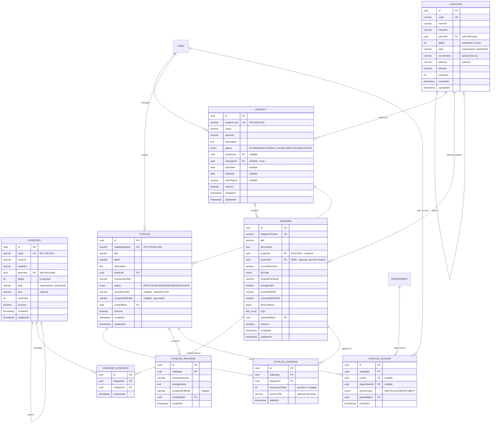

### 2.2 Changes to Existing Entities — Diff View

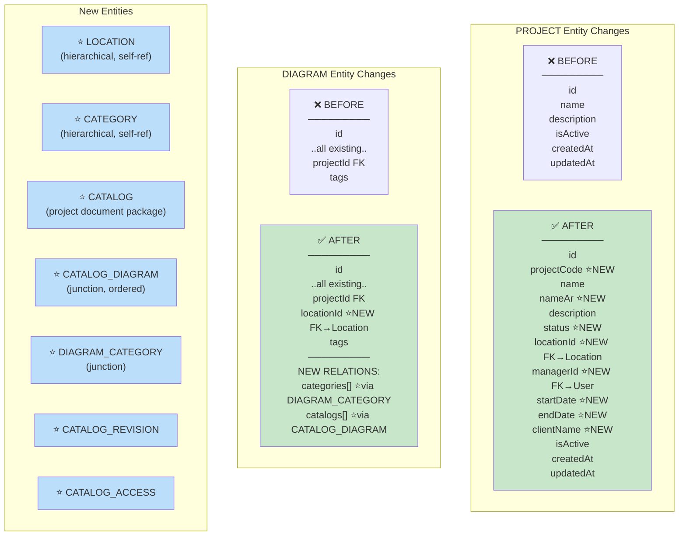

### 2.3 Hierarchical Data Model — Tree Structures

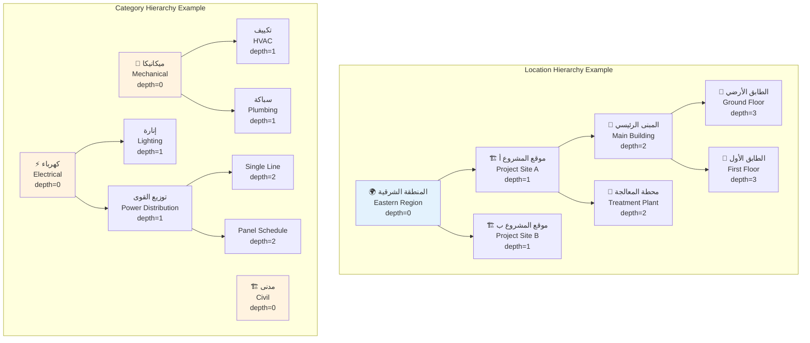

---

## 3. Impact on Existing API Endpoints

### 3.1 Modified Endpoints

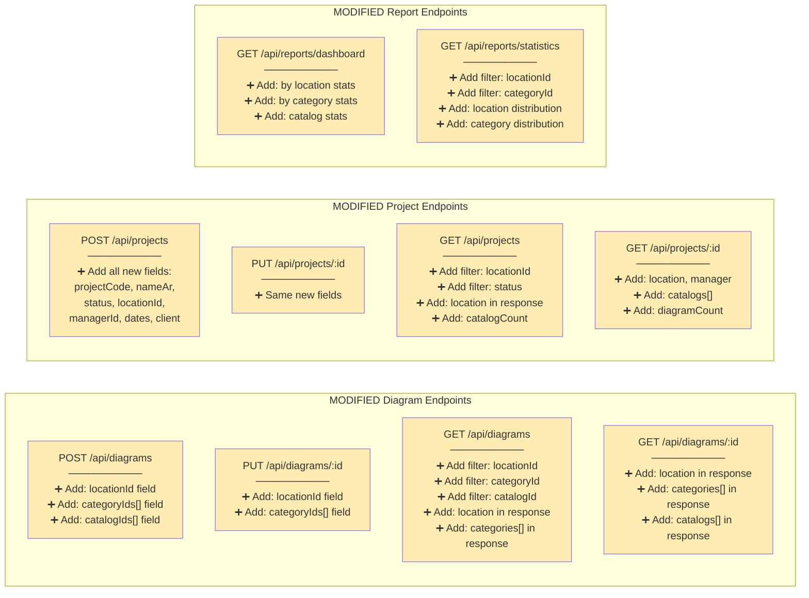

### 3.2 New API Endpoints

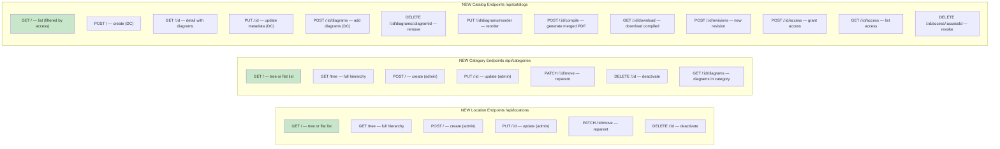

---

## 4. Impact on Frontend

### 4.1 New Pages

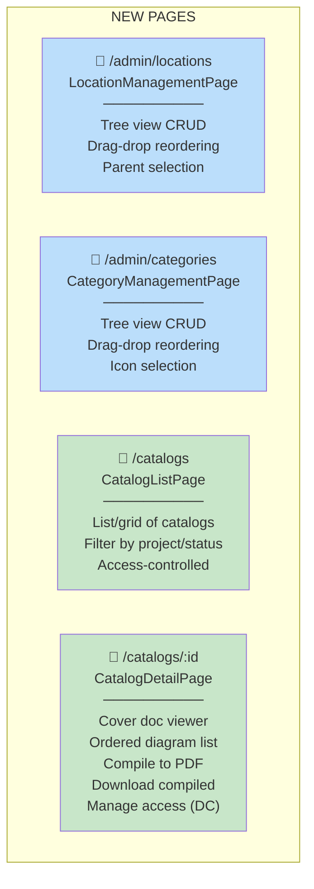

### 4.2 Modified Pages — Detailed Impact

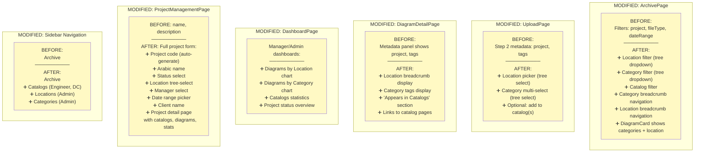

### 4.3 New Shared Components

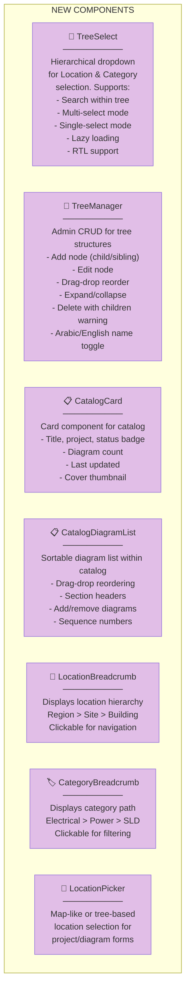

---

## 5. Impact on Existing Backend Modules

### 5.1 Module-by-Module Impact

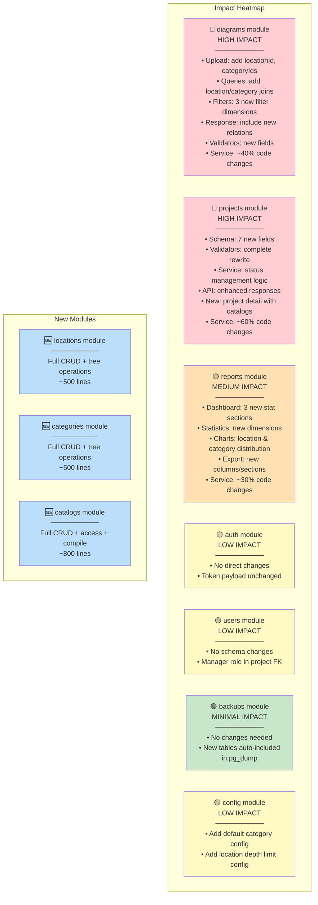

### 5.2 Database Migration Impact

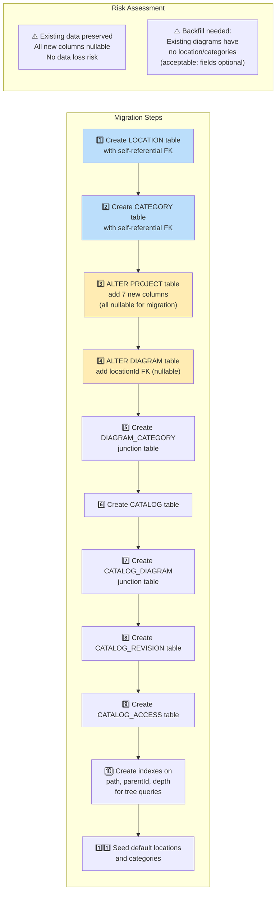

---

## 6. Impact on Permissions & Access Control

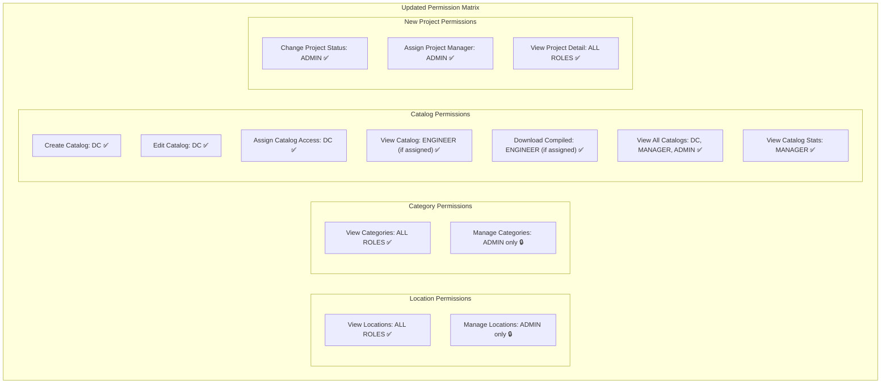

### Access Control Logic Change for Catalogs

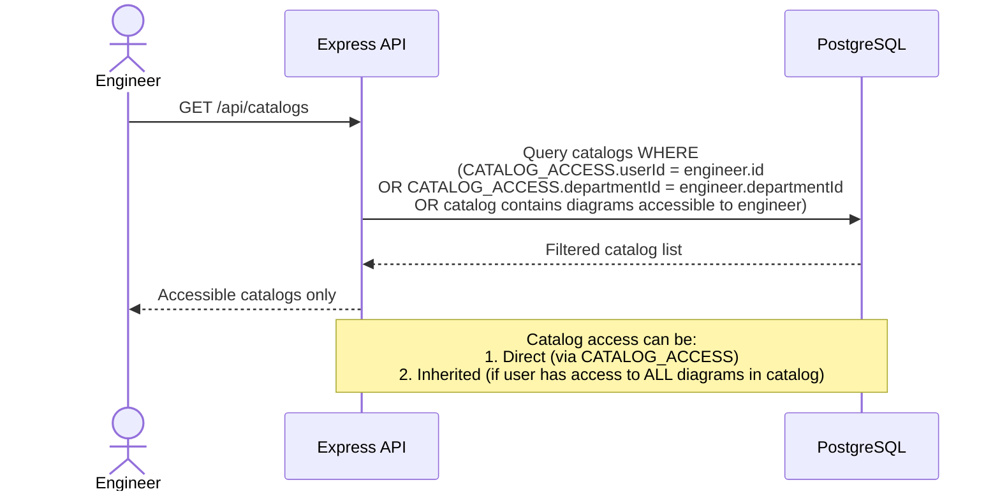

---

## 7. Revised Prisma Schema Additions

```prisma
// Add to prisma/schema.prisma:

model Location {
  id          String     @id @default(uuid())
  code        String     @unique
  nameAr      String
  nameEn      String
  parentId    String?
  parent      Location?  @relation("LocationTree", fields: [parentId], references: [id])
  children    Location[] @relation("LocationTree")
  depth       Int        @default(0)
  path        String     @default("/")  // materialized path: /uuid1/uuid2/
  coordinates String?
  address     String?
  sortOrder   Int        @default(0)
  isActive    Boolean    @default(true)
  createdAt   DateTime   @default(now())
  updatedAt   DateTime   @updatedAt

  projects    Project[]
  diagrams    Diagram[]

  @@index([parentId])
  @@index([path])
  @@index([depth])
}

model Category {
  id        String     @id @default(uuid())
  code      String     @unique
  nameAr    String
  nameEn    String
  parentId  String?
  parent    Category?  @relation("CategoryTree", fields: [parentId], references: [id])
  children  Category[] @relation("CategoryTree")
  depth     Int        @default(0)
  path      String     @default("/")
  icon      String?
  sortOrder Int        @default(0)
  isActive  Boolean    @default(true)
  createdAt DateTime   @default(now())
  updatedAt DateTime   @updatedAt

  diagrams  DiagramCategory[]

  @@index([parentId])
  @@index([path])
}

model DiagramCategory {
  id         String   @id @default(uuid())
  diagramId  String
  diagram    Diagram  @relation(fields: [diagramId], references: [id])
  categoryId String
  category   Category @relation(fields: [categoryId], references: [id])
  assignedAt DateTime @default(now())

  @@unique([diagramId, categoryId])
}

enum ProjectStatus {
  PLANNING
  ACTIVE
  ON_HOLD
  COMPLETED
  ARCHIVED
}

// MODIFY existing Project model:
model Project {
  id          String        @id @default(uuid())
  projectCode String        @unique
  name        String        @unique
  nameAr      String?
  description String?
  status      ProjectStatus @default(PLANNING)
  locationId  String?
  location    Location?     @relation(fields: [locationId], references: [id])
  managerId   String?
  manager     User?         @relation("ProjectManager", fields: [managerId], references: [id])
  startDate   DateTime?
  endDate     DateTime?
  clientName  String?
  isActive    Boolean       @default(true)
  createdAt   DateTime      @default(now())
  updatedAt   DateTime      @updatedAt

  diagrams    Diagram[]
  catalogs    Catalog[]
}

enum CatalogStatus {
  DRAFT
  PUBLISHED
  REVISED
  ARCHIVED
}

model Catalog {
  id              String        @id @default(uuid())
  catalogNumber   String        @unique
  title           String
  titleAr         String?
  description     String?
  projectId       String
  project         Project       @relation(fields: [projectId], references: [id])
  revisionNumber  String        @default("Rev-00")
  status          CatalogStatus @default(DRAFT)
  coverDocPath    String?
  compiledPdfPath String?
  createdById     String
  createdBy       User          @relation("CatalogCreator", fields: [createdById], references: [id])
  isActive        Boolean       @default(true)
  createdAt       DateTime      @default(now())
  updatedAt       DateTime      @updatedAt

  diagrams        CatalogDiagram[]
  revisions       CatalogRevision[]
  accessRules     CatalogAccess[]
}

model CatalogDiagram {
  id            String   @id @default(uuid())
  catalogId     String
  catalog       Catalog  @relation(fields: [catalogId], references: [id])
  diagramId     String
  diagram       Diagram  @relation(fields: [diagramId], references: [id])
  sequenceOrder Int
  sectionTitle  String?
  addedAt       DateTime @default(now())

  @@unique([catalogId, diagramId])
  @@index([catalogId, sequenceOrder])
}

model CatalogRevision {
  id              String   @id @default(uuid())
  catalogId       String
  catalog         Catalog  @relation(fields: [catalogId], references: [id])
  revisionNumber  String
  changeNotes     String?
  compiledPdfPath String?
  createdById     String
  createdBy       User     @relation("CatalogRevisionCreator", fields: [createdById], references: [id])
  createdAt       DateTime @default(now())
}

model CatalogAccess {
  id           String     @id @default(uuid())
  catalogId    String
  catalog      Catalog    @relation(fields: [catalogId], references: [id])
  userId       String?
  user         User?      @relation("CatalogAccessUser", fields: [userId], references: [id])
  departmentId String?
  department   Department? @relation(fields: [departmentId], references: [id])
  accessType   AccessType
  grantedById  String
  grantedBy    User       @relation("CatalogAccessGranter", fields: [grantedById], references: [id])
  createdAt    DateTime   @default(now())

  @@unique([catalogId, userId])
  @@unique([catalogId, departmentId])
}

// MODIFY existing Diagram model — add:
model Diagram {
  // ... existing fields ...
  locationId  String?
  location    Location?  @relation(fields: [locationId], references: [id])
  
  // ... existing relations ...
  categories  DiagramCategory[]
  catalogs    CatalogDiagram[]
}
```

---

## 8. Impact on Search & Filtering

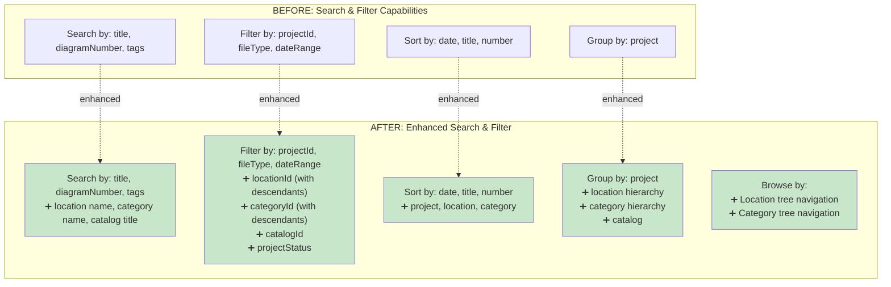

### Key Query Impact — Hierarchical Filtering

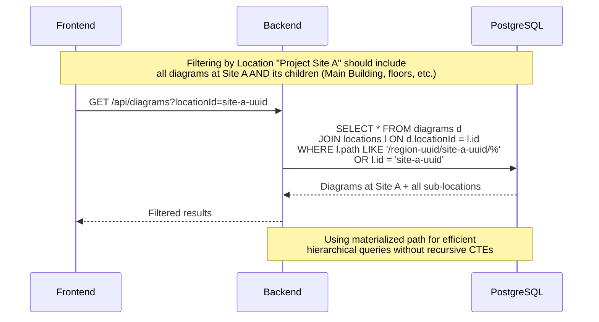

---

## 9. Impact on Existing Task Prompts

### 9.1 Tasks That Need Modification

| Original Task | Impact | Changes Required |
|---------------|--------|-----------------|
| **Task 2: DB Schema** | 🔴 Heavy | Add 7 new models, modify 2 existing models, new enums, new seed data |
| **Task 5: Dept & Project** | 🔴 Heavy | Project module completely rewritten with enhanced fields, status management |
| **Task 7: Diagram Module** | 🔴 Heavy | Upload accepts locationId + categoryIds, queries include new joins/filters |
| **Task 8: Reports** | 🟡 Medium | New dimensions in stats (location, category, catalog) |
| **Task 10: Config** | 🟢 Light | Add category/location depth limits to config |
| **Task 12: Dashboard** | 🟡 Medium | New chart sections for location/category distribution |
| **Task 13: Archive Page** | 🔴 Heavy | New filter dimensions, tree navigation, category/location breadcrumbs |
| **Task 14: Diagram Detail** | 🟡 Medium | Show location, categories, catalogs in metadata panel |
| **Task 15: Upload Page** | 🟡 Medium | Add location picker + category selector in Step 2 |
| **Task 16: Admin Pages** | 🟡 Medium | Add Location + Category management pages; enhance Project page |
| **Task 17: API Integration** | 🟡 Medium | Register 3 new route modules |

### 9.2 New Tasks Required

| New Task | Sprint | Effort |
|----------|--------|--------|
| **Task 2B: Extended Schema Migration** | Sprint 1 | 1 day |
| **Task 5B: Location Module (Backend)** | Sprint 2 | 2 days |
| **Task 5C: Category Module (Backend)** | Sprint 2 | 2 days |
| **Task 7B: Catalog Module (Backend)** | Sprint 3 | 3 days |
| **Task 13B: Tree Navigation Components** | Sprint 6 | 2 days |
| **Task 16B: Location & Category Admin Pages** | Sprint 7 | 2 days |
| **Task 16C: Catalog Pages (List + Detail)** | Sprint 7 | 3 days |

---

## 10. New Task Prompts for AI Agent

### TASK 5B: Location Module (Backend)

```text
You are a senior backend engineer. Build the Location management module for the EDMS system.

Context: Express + TypeScript + Prisma + PostgreSQL. Locations form a HIERARCHICAL TREE using the Materialized Path pattern. Auth and role middleware exist.

Location Schema (already in Prisma):
- id (UUID), code (unique), nameAr, nameEn, parentId (self-ref FK), depth (int), path (materialized: "/uuid1/uuid2/"), coordinates (optional), address (optional), sortOrder, isActive, createdAt, updatedAt

Create src/modules/locations/:

1. location.validators.ts (zod):
   - createSchema: { code (required, 3-50, alphanumeric+hyphens, unique), nameAr (required, 2-255), nameEn (required, 2-255), parentId (optional UUID), coordinates (optional string "lat,lng"), address (optional, max 500), sortOrder (optional int, default 0) }
   - updateSchema: { nameAr?, nameEn?, coordinates?, address?, sortOrder? } (code and parent NOT updatable via update — use move)
   - moveSchema: { newParentId: UUID | null } (null = make root)

2. location.service.ts (LocationService class):

   create(data):
   - If parentId provided: validate parent exists and is active
   - Calculate depth = parent.depth + 1 (or 0 if root)
   - Calculate path = parent.path + id + "/" (or "/" + id + "/" if root)
   - Validate max depth (configurable, default 6 levels)
   - Create location
   - Return with parent info

   update(id, data):
   - Update allowed fields (NOT parentId or code)
   - Return updated location

   move(id, newParentId):
   - Validate no circular reference (newParentId is not a descendant of id)
   - Recalculate depth and path for the moved node AND ALL DESCENDANTS
   - Use transaction to update all affected records
   - Update path: replace old ancestor path prefix with new one
   - This is the most complex operation

   findAll(includeInactive?: boolean):
   - Return flat list of all locations
   - Include: childrenCount, projectCount, diagramCount for each

   getTree(rootId?: string):
   - If rootId: return subtree starting from that node
   - If no rootId: return entire tree
   - Build tree structure in memory from flat query (more efficient than recursive)
   - Return nested: { ...location, children: [...] }
   - Algorithm: 
     1. Query all locations ordered by path
     2. Build map by id
     3. Iterate and attach each to its parent's children array

   findById(id):
   - Return location with: parent chain (ancestors), direct children, projects, diagram count

   getAncestors(id):
   - Parse path to get ancestor IDs
   - Query all ancestors
   - Return ordered array from root to parent

   getDescendants(id):
   - Query WHERE path LIKE location.path + '%'
   - Returns all descendants at all levels

   getDescendantIds(id):
   - Same but returns just IDs (for use in diagram filtering)

   toggleStatus(id, isActive):
   - If deactivating: also deactivate all descendants
   - If activating: ensure all ancestors are active

   getStats(id):
   - Return { directChildren, totalDescendants, projectCount, diagramCount }

3. location.controller.ts:
   - GET / — all authenticated (flat list, query: ?includeInactive=true for admin)
   - GET /tree — all authenticated (tree structure, query: ?rootId=uuid)
   - POST / — admin only
   - GET /:id — all authenticated (with ancestors and children)
   - PUT /:id — admin only
   - PATCH /:id/move — admin only (body: { newParentId })
   - PATCH /:id/status — admin only
   - GET /:id/ancestors — all authenticated
   - GET /:id/descendants — all authenticated

4. location.routes.ts

CRITICAL IMPLEMENTATION NOTES:
- Use materialized path ("/uuid1/uuid2/uuid3/") for efficient hierarchical queries
- The path column enables: finding all descendants with LIKE, finding depth with counting separators
- Index the path column for LIKE query performance
- When moving a node, ALL descendant paths must be updated in a single transaction
- Use Prisma.$transaction for move operations
- Audit log all write operations
- Handle circular reference prevention in move operation

Output all files with complete content.
```

---

### TASK 5C: Category Module (Backend)

```text
You are a senior backend engineer. Build the Category management module for the EDMS system.

Context: Express + TypeScript + Prisma. Categories are a HIERARCHICAL TREE (identical pattern to Locations). Used for classifying diagrams by discipline/type.

Category schema: id, code (unique), nameAr, nameEn, parentId (self-ref), depth, path (materialized), icon (optional), sortOrder, isActive, createdAt, updatedAt

Junction table: DiagramCategory (diagramId FK, categoryId FK, assignedAt)

Create src/modules/categories/:

1. category.validators.ts (zod):
   - createSchema: { code (required, 3-50, unique), nameAr (required), nameEn (required), parentId (optional UUID), icon (optional string), sortOrder (optional int) }
   - updateSchema: { nameAr?, nameEn?, icon?, sortOrder? }
   - moveSchema: { newParentId: UUID | null }
   - assignDiagramsSchema: { categoryIds: UUID[] } (for bulk assign to a diagram)

2. category.service.ts:
   - Identical tree operations to LocationService: create, update, move, findAll, getTree, findById, getAncestors, getDescendants, toggleStatus
   
   ADDITIONAL METHODS:
   - assignTodiagram(diagramId, categoryIds): replace all category assignments for a diagram (delete existing + insert new, in transaction)
   - getDiagramCategories(diagramId): return categories assigned to a diagram with full path
   - getCategoryDiagrams(categoryId, includeDescendants, pagination): return diagrams in this category (optionally including all descendant categories)
   - getPopularCategories(limit): top categories by diagram count
   - getCategoryTree WithCounts(): tree with diagramCount at each node (including descendant counts)

3. category.controller.ts:
   - GET / — all authenticated
   - GET /tree — all authenticated (with optional ?withCounts=true)
   - POST / — admin only
   - GET /:id — all authenticated (with ancestors + children + diagram count)
   - PUT /:id — admin only
   - PATCH /:id/move — admin only
   - PATCH /:id/status — admin only
   - GET /:id/diagrams — all authenticated (paginated, filtered by access)
   - GET /popular — all authenticated (top categories)

4. category.routes.ts

Seed data for categories:
Create prisma seed that adds default engineering categories:
- كهرباء / Electrical
  - توزيع القوى / Power Distribution
  - إنارة / Lighting
  - تيار خفيف / Low Current
- ميكانيكا / Mechanical
  - تكييف / HVAC
  - سباكة / Plumbing
  - إطفاء حريق / Fire Fighting
- مدنى / Civil
  - إنشائى / Structural
  - معمارى / Architectural
- ري / Irrigation
  - شبكات رى / Irrigation Networks
  - محطات ضخ / Pump Stations

Output all files with complete content.
```

---

### TASK 7B: Catalog Module (Backend)

```text
You are a senior backend engineer. Build the Catalog module for the EDMS system.

Context: Express + TypeScript + Prisma + MinIO. A Catalog is a comprehensive document package for a project, containing an ordered collection of diagrams with optional cover document.

Models: Catalog, CatalogDiagram (junction with order), CatalogRevision, CatalogAccess

Create src/modules/catalogs/:

1. catalog.validators.ts (zod):
   - createSchema: {
       title (required, 3-500),
       titleAr (optional),
       description (optional, max 2000),
       projectId (required UUID),
       revisionNumber (optional, default "Rev-00")
     }
   - updateSchema: { title?, titleAr?, description?, status? }
   - addDiagramsSchema: { 
       diagrams: Array<{ diagramId: UUID, sequenceOrder: int, sectionTitle?: string }>
     }
   - reorderSchema: {
       order: Array<{ catalogDiagramId: UUID, sequenceOrder: int }>
     }
   - accessSchema: { targets: Array<{ type: 'user'|'department', id: UUID }> }

2. catalog.service.ts (CatalogService class):

   create(data, createdById):
   - Generate catalogNumber: "CAT-{projectCode}-{sequence}"
   - Create catalog with DRAFT status
   - Optionally handle cover document upload (multer file)
   - Return created catalog

   update(id, data, updatedById):
   - Only DC can update
   - Validate status transitions: DRAFT→PUBLISHED, PUBLISHED→REVISED, any→ARCHIVED
   - If status changing to PUBLISHED: validate at least 1 diagram in catalog
   - Log audit

   findAll(userId, role, departmentId, filters, pagination):
   - If ENGINEER: filter by CatalogAccess (same pattern as DiagramAccess)
   - If DC/MANAGER/ADMIN: see all
   - Filters: projectId, status, search (title, catalogNumber), dateRange
   - Include: project name, diagram count, created by, last updated

   findById(id, requestingUser):
   - Verify access
   - Return catalog with: project, diagrams (ordered by sequenceOrder with diagram details), revisions, access rules, created by
   - Log VIEW audit

   addDiagrams(catalogId, diagrams, addedById):
   - Validate all diagramIds exist and belong to same project as catalog
   - Insert CatalogDiagram records
   - Avoid duplicates (upsert)
   - Return updated diagram list

   removeDiagram(catalogId, catalogDiagramId):
   - Delete CatalogDiagram record
   - Reorder remaining (fill sequence gaps)

   reorderDiagrams(catalogId, order):
   - Update sequenceOrder for each CatalogDiagram
   - Transaction

   compileToPdf(catalogId):
   - Fetch all diagrams in order
   - For each diagram: get the viewable file (converted PDF or original if PDF)
   - Use pdf-lib or PDFKit to merge:
     1. Cover page (if cover doc exists, or generate one with title, project, date, TOC)
     2. Table of Contents page (auto-generated with section titles + page numbers)
     3. Each diagram as a section, with section title page if sectionTitle provided
   - Upload compiled PDF to MinIO
   - Update catalog.compiledPdfPath
   - Return compiled file path + size
   - This is a heavy operation — use Bull queue

   downloadCompiled(catalogId, requestingUser):
   - Verify access
   - Check compiledPdfPath exists (if not: return error "not compiled yet")
   - Stream from MinIO
   - Log DOWNLOAD audit

   uploadCoverDoc(catalogId, file):
   - Accept PDF only
   - Upload to MinIO: /catalogs/{catalogId}/cover.pdf
   - Update catalog.coverDocPath
   - Regenerate compiled if exists

   createRevision(catalogId, revisionData, createdById):
   - Create CatalogRevision record
   - Update catalog.revisionNumber
   - Optionally re-compile

   grantAccess(catalogId, targets, grantedById):
   - Same pattern as DiagramAccess
   - Insert CatalogAccess records

   revokeAccess(catalogId, accessId):
   - Delete CatalogAccess

   getAccess(catalogId):
   - Return access list with user/department details

3. catalog.controller.ts:
   - GET / — all authenticated (filtered by access)
   - POST / — DC only (multipart for optional cover doc)
   - GET /:id — all authenticated (with access check)
   - PUT /:id — DC only
   - DELETE /:id — DC only (soft delete)
   
   - POST /:id/diagrams — DC only (add diagrams)
   - DELETE /:id/diagrams/:catalogDiagramId — DC only
   - PUT /:id/diagrams/reorder — DC only
   
   - POST /:id/compile — DC only (triggers compilation)
   - GET /:id/download — all authenticated (download compiled PDF)
   - POST /:id/cover — DC only (upload cover document)
   
   - POST /:id/revisions — DC only
   - GET /:id/revisions — all authenticated
   
   - POST /:id/access — DC only
   - GET /:id/access — DC only
   - DELETE /:id/access/:accessId — DC only

4. catalog.routes.ts

Create src/workers/catalogCompileWorker.ts:
   - Bull worker for heavy PDF compilation
   - Takes catalogId from job data
   - Calls catalogService.compileToPdf
   - Updates catalog record on completion

Install: pdf-lib (for merging PDFs), @pdf-lib/fontkit (for Arabic font support in cover pages)

Output all files with complete content.
```

---

### TASK 13B: Tree Navigation Components (Frontend)

```text
You are a senior React frontend engineer. Build reusable tree navigation and selection components for the EDMS system.

Context: React 18 + TypeScript + Ant Design 5 (with RTL support). These components are used for Location and Category hierarchies throughout the application.

Create:

1. src/components/tree/HierarchicalTreeSelect.tsx:
   - A dropdown tree selector using Ant Design TreeSelect
   - Props:
     - treeData: TreeNode[] (from API)
     - value: string | string[] (selected IDs)
     - onChange: (value) => void
     - mode: 'single' | 'multiple'
     - placeholder: string
     - showSearch: boolean (default true)
     - labelField: 'nameAr' | 'nameEn' (based on current language)
     - showPath: boolean (show full path as label, e.g., "Electrical > Power > SLD")
     - allowClear: boolean
     - maxDepth: number (optional, limit selectable depth)
     - loading: boolean
   - Features:
     - Search within tree nodes (filters visible nodes)
     - Shows node count badges
     - Lazy loading of children (optional, for large trees)
     - RTL-aware indentation
     - Disabled nodes (inactive items)
     - "Select all children" option on parent nodes (in multiple mode)

2. src/components/tree/TreeManager.tsx:
   - Full CRUD admin component for managing tree structures
   - Props:
     - treeData: TreeNode[]
     - onAdd: (parentId, data) => Promise<void>
     - onUpdate: (id, data) => Promise<void>
     - onMove: (id, newParentId) => Promise<void>
     - onToggleStatus: (id, isActive) => Promise<void>
     - onReorder: (id, direction: 'up'|'down') => Promise<void>
     - entityName: string (for labels: "Location" or "Category")
     - formFields: FormFieldConfig[] (dynamic form fields for add/edit)
   - Features:
     - Ant Design Tree with custom node rendering
     - Each node shows: icon, Arabic name, English name, code, item count, status badge
     - Node actions (on hover or context menu): Add Child, Edit, Move, Deactivate, Reorder Up/Down
     - Drag-and-drop to move nodes (using ant design tree's draggable)
     - Add node: inline form or modal with: code, nameAr, nameEn, icon (optional)
     - Edit node: modal with same fields
     - Move node: modal with tree selector for new parent
     - Expand/collapse all buttons
     - Search/filter tree
     - Color-code inactive nodes (grayed out)
     - Confirmation dialog for deactivation (warns about children)

3. src/components/tree/TreeBreadcrumb.tsx:
   - Displays the ancestry path of a selected node
   - Props:
     - ancestors: Array<{id, nameAr, nameEn}>
     - current: {id, nameAr, nameEn}
     - onClick: (nodeId) => void (navigate/filter)
     - separator: string (default " > ")
   - Renders: Root > Parent > ... > Current
   - Each segment is clickable
   - Uses current language for names
   - RTL-aware direction

4. src/components/tree/TreeNavigationPanel.tsx:
   - Sidebar panel for browsing by hierarchy
   - Props:
     - treeData: TreeNode[]
     - selectedId: string | null
     - onSelect: (nodeId) => void
     - title: string
     - collapsible: boolean
   - Features:
     - Collapsible panel
     - Tree with expand/collapse
     - Click node to filter main content
     - Item count badges on each node
     - Highlight selected node
     - Search input at top

5. src/hooks/useTree.ts:
   - Custom hook for tree data management
   - Fetches tree data from API
   - Methods:
     - flatToTree(flatData): converts flat list to nested tree
     - findNode(tree, id): finds node in tree
     - getAncestors(tree, id): returns ancestor chain
     - filterTree(tree, searchText): returns filtered tree
     - addNode(parentId, data): API call + local state update
     - updateNode(id, data): API call + local state update
     - moveNode(id, newParentId): API call + local state update
   - Returns: { tree, flatData, loading, error, actions }

6. src/api/locationApi.ts:
   - getAll(): GET /locations
   - getTree(rootId?): GET /locations/tree
   - create(data): POST /locations
   - update(id, data): PUT /locations/:id
   - move(id, newParentId): PATCH /locations/:id/move
   - toggleStatus(id, isActive): PATCH /locations/:id/status

7. src/api/categoryApi.ts:
   - getAll(): GET /categories
   - getTree(withCounts?): GET /categories/tree
   - create(data): POST /categories
   - update(id, data): PUT /categories/:id
   - move(id, newParentId): PATCH /categories/:id/move
   - toggleStatus(id, isActive): PATCH /categories/:id/status
   - getDiagrams(id, params): GET /categories/:id/diagrams

8. src/types/tree.ts:
   - interface TreeNode { id, code, nameAr, nameEn, parentId, depth, children?: TreeNode[], isActive, icon?, sortOrder, _count?: { diagrams, projects } }
   - interface FlatTreeItem { ...TreeNode without children, path: string }

Ensure:
- All components work correctly in RTL mode
- Tree indentation uses margin-inline-start (not margin-left)
- Arabic names display correctly
- Drag-and-drop works in RTL
- Ant Design Tree's built-in features are leveraged where possible
- Accessible: keyboard navigation, ARIA tree role

Output all files with complete content.
```

---

### TASK 16C: Catalog Pages (Frontend)

```text
You are a senior React frontend engineer. Build the Catalog listing and detail pages for the EDMS system.

Context: React 18 + TypeScript + Ant Design 5. Catalogs are comprehensive document packages for projects. DC creates them, Engineers view assigned ones.

Create:

1. src/api/catalogApi.ts:
   - getAll(params: { page, limit, projectId?, status?, search? }): GET /catalogs
   - getById(id): GET /catalogs/:id
   - create(formData): POST /catalogs (multipart for cover doc)
   - update(id, data): PUT /catalogs/:id
   - addDiagrams(id, diagrams): POST /catalogs/:id/diagrams
   - removeDiagram(id, catalogDiagramId): DELETE /catalogs/:id/diagrams/:cdId
   - reorderDiagrams(id, order): PUT /catalogs/:id/diagrams/reorder
   - compile(id): POST /catalogs/:id/compile
   - downloadCompiled(id): GET /catalogs/:id/download (blob)
   - uploadCover(id, file): POST /catalogs/:id/cover
   - grantAccess(id, targets): POST /catalogs/:id/access
   - getAccess(id): GET /catalogs/:id/access
   - revokeAccess(id, accessId): DELETE /catalogs/:id/access/:accessId

2. src/pages/CatalogListPage.tsx:
   - Header with title "الكتالوجات / Catalogs" + "Create Catalog" button (DC only)
   - Filters: project dropdown, status dropdown, search input
   - Display as cards (grid) or table (list) with toggle
   
   Card view (CatalogCard):
   - Cover thumbnail (or default cover icon)
   - Title (Arabic + English)
   - Project name badge
   - Status badge (color: DRAFT=gray, PUBLISHED=green, REVISED=orange, ARCHIVED=red)
   - Diagram count icon
   - Revision number
   - Last updated date
   - Created by
   - Click → /catalogs/:id

   Table view columns: Cover, Title, Project, Status, Diagrams, Revision, Updated, Created By, Actions

   Pagination at bottom
   Empty state: "No catalogs found"
   Loading: skeleton cards

3. src/pages/CatalogDetailPage.tsx:
   Layout: Full-width page with sections

   TOP SECTION:
   - Breadcrumb: Catalogs > {Project Name} > {Catalog Title}
   - Title + revision badge + status badge
   - Action buttons (DC only):
     - "Edit" → edit metadata modal
     - "Compile PDF" → triggers compilation (with loading)
     - "Download PDF" → downloads compiled version (disabled if not compiled)
     - "Upload Cover" → file upload
     - "Manage Access" → access modal
     - "Change Status" → status transition dropdown
   - Metadata: project, description, created by, created date, last updated

   COVER SECTION (if cover doc exists):
   - Small preview of cover document
   - "View Cover" / "Replace Cover" buttons

   DIAGRAMS SECTION:
   - Title: "Diagrams in this Catalog ({count})"
   - DC: "Add Diagrams" button → opens diagram picker modal
   
   Ordered list of diagrams:
   - Each item shows: sequence number, section title (editable inline for DC), thumbnail, diagram title, diagram number, file type, revision
   - DC can: drag-drop reorder, remove (with confirmation), edit section title
   - Engineer can: click to view diagram detail
   - Section headers (if sectionTitle changes between items, show divider with title)
   - Use @dnd-kit/sortable or ant design's sortable list for drag-drop

   REVISION HISTORY SECTION:
   - Timeline: revision number, date, author, notes
   - DC: "Create New Revision" button → modal with revision number + change notes

   ACCESS SECTION (DC only):
   - Same AccessSelector component used for diagrams
   - List of current access with revoke buttons

4. src/components/catalog/CatalogCard.tsx:
   - Reusable card for grid view

5. src/components/catalog/CreateCatalogModal.tsx:
   - Modal with form: title, titleAr, project (select), description, cover document (file upload optional)
   - On submit: creates catalog and navigates to detail page

6. src/components/catalog/DiagramPickerModal.tsx:
   - Modal for DC to add diagrams to a catalog
   - Shows diagrams from the SAME PROJECT as the catalog
   - Search + filter (file type, category)
   - Checkbox selection (multi-select)
   - Already-added diagrams shown as disabled/checked
   - Section title input for each selected diagram (optional)
   - "Add Selected" button

7. src/components/catalog/SortableDiagramList.tsx:
   - Sortable list component using @dnd-kit/sortable
   - Each item: drag handle, sequence #, thumbnail, title, number, type, section title
   - Drag-drop updates order
   - Auto-saves reorder after drag ends (debounced API call)
   - Remove button with confirmation

8. Add to sidebar navigation:
   - "الكتالوجات / Catalogs" menu item (visible to Engineer + DC)
   - Under Archive section or as separate item

Ensure:
- Drag-and-drop works with RTL
- Compile PDF shows progress indicator (poll for completion)
- Download works for large files (streaming)
- Responsive layout for all sections
- Arabic translations complete

Output all files with complete content.
```

---

## 11. Updated Navigation & Sitemap

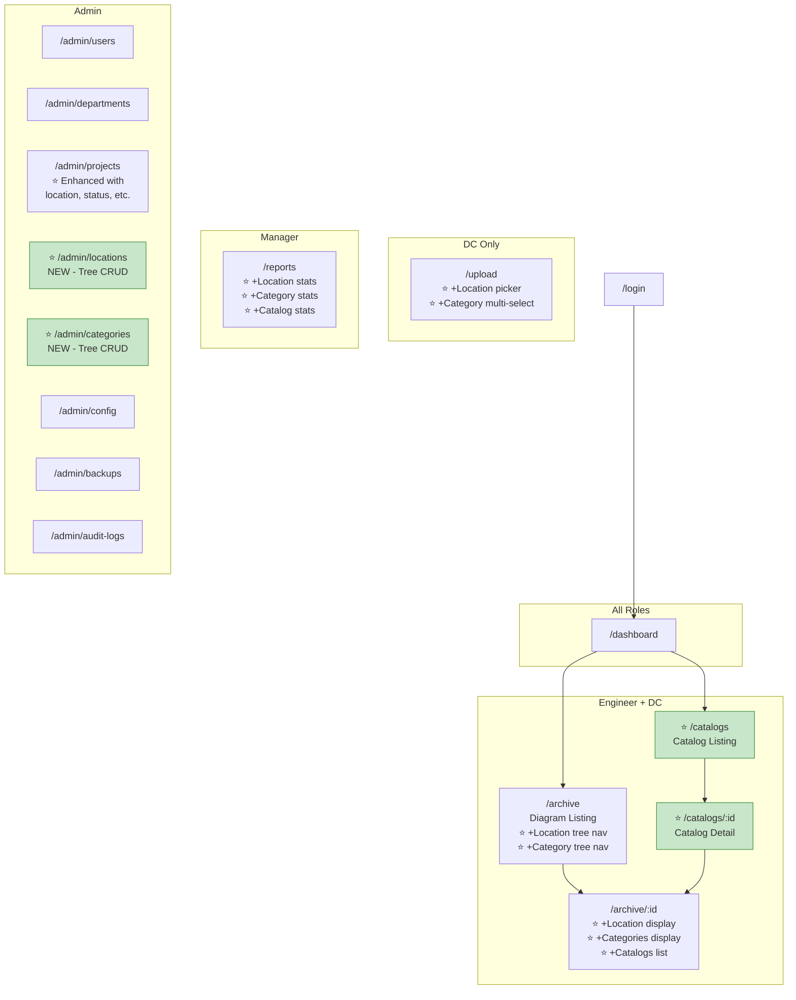

---

## 12. Revised Sprint Plan

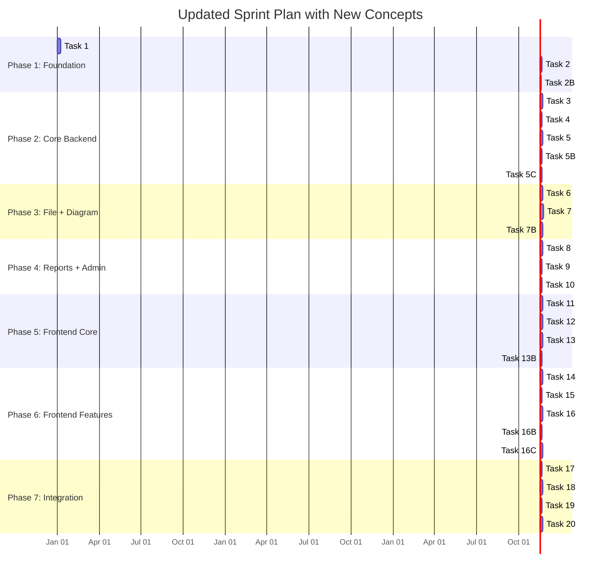

### Updated Timeline Comparison

| Metric | Original Plan | With New Concepts | Delta |
|--------|--------------|-------------------|-------|
| Total Tasks | 20 | 27 (20 modified + 7 new) | +7 tasks |
| Total Sprints | 10 | 12 | +2 sprints |
| Total Duration | 18 weeks | 23 weeks | **+5 weeks** |
| New DB Tables | 0 | 7 | +7 |
| New API Endpoints | 0 | 24 | +24 |
| Modified API Endpoints | 0 | 14 | +14 |
| New Frontend Pages | 0 | 4 | +4 |
| New Frontend Components | 0 | ~12 | +12 |

---

## 13. Risk Assessment for New Concepts

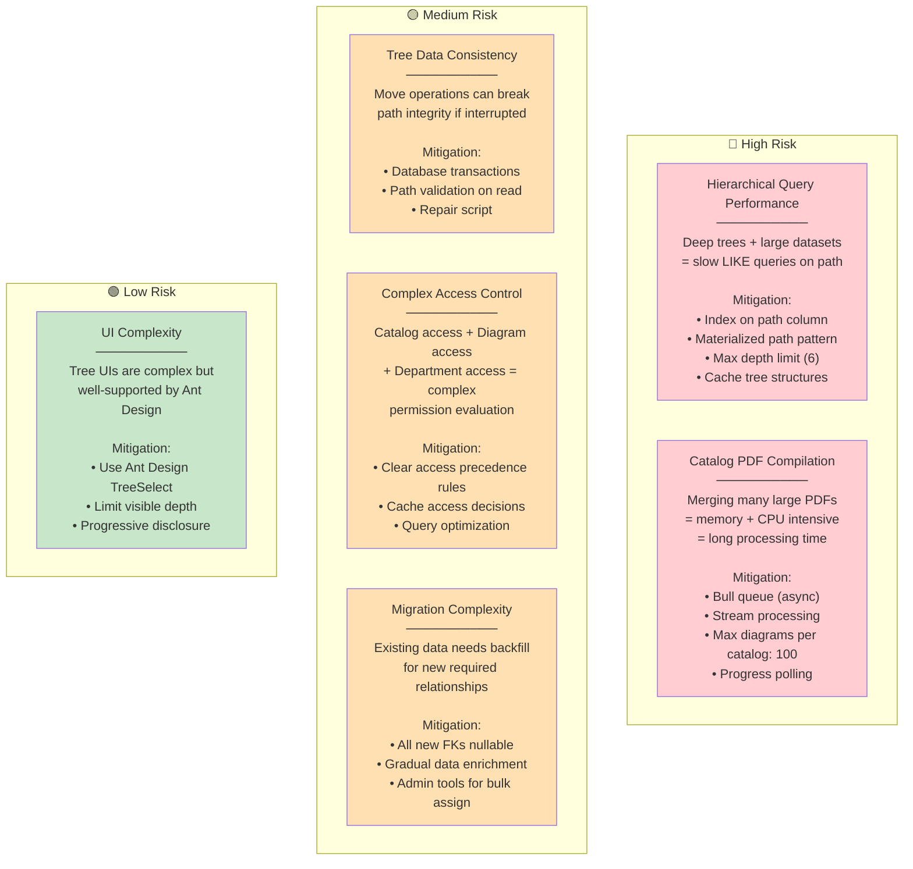

---

## 14. Summary Decision Matrix

| Concept | Implement Now? | Justification |
|---------|---------------|---------------|
| **Project Enhancement** | ✅ Yes — Sprint 2 | Low incremental cost, high organizational value, already partially exists |
| **Location** | ✅ Yes — Sprint 2 | Critical for engineering organizations, fundamental to diagram context |
| **Categories** | ✅ Yes — Sprint 2 | Essential for diagram discovery and navigation, core UX improvement |
| **Catalogs** | ✅ Yes — Sprint 3 | Differentiating feature, aligns with engineering workflows, depends on Diagrams module |

**Recommendation:** Implement all four concepts. The 5-week additional investment yields a significantly more powerful and professionally relevant system. The hierarchical tree pattern is reused for both Locations and Categories, so the second one is ~40% less effort. Catalogs add the most complexity but provide the most distinctive value.