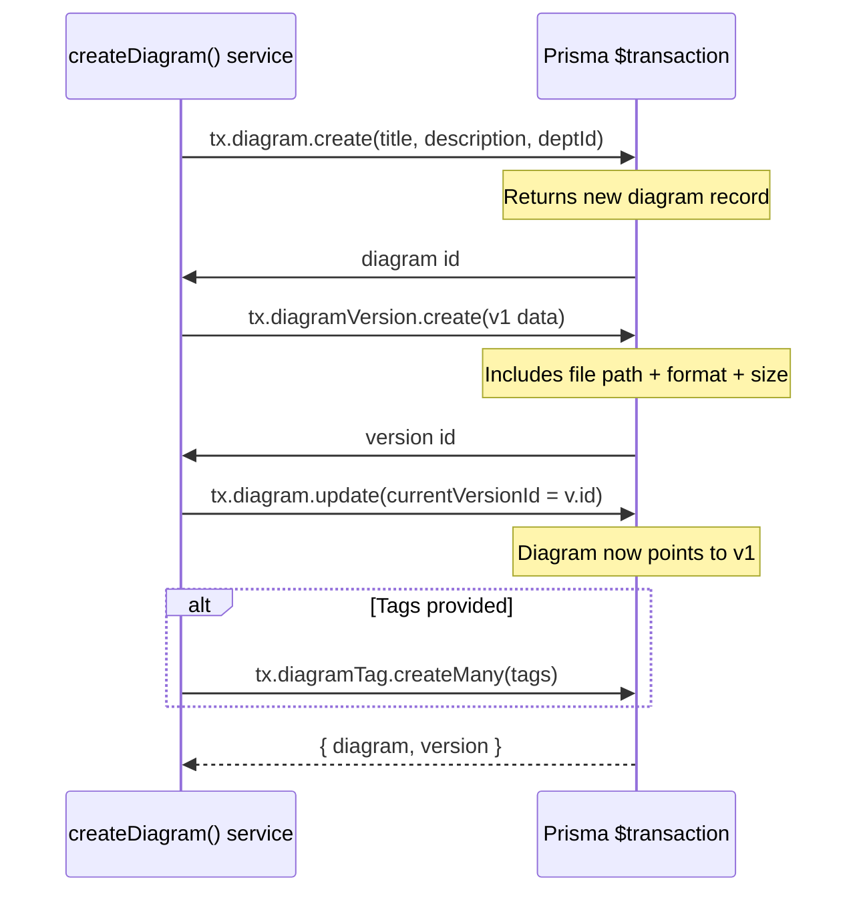

# Flow Diagram: Create Diagram - Frontend to Backend

## Complete Request Lifecycle

### 1. Frontend Route Entry Point
**File:** `packages/frontend/src/routes/_authenticated/diagrams/create.tsx`  
**Route Path:** `/diagrams/create`

```typescript
// Expected implementation (current: placeholder)
const CreateDiagramPage = () => {
  return (
    <div>Hello /diagrams/create!</div>
  );
};
```

**Expected Flow:** User navigates to create page → Form UI renders → Upload file + input metadata → Submit button clicked

---

### 2. Frontend API Call (Not Implemented Yet)

When form is submitted, frontend should:

| Step | Component/Logic | Purpose |
|------|-----------------|---------|
| File Upload | Multi-file upload with FormData | Send diagram files + metadata |
| Validation | Client-side schema validation | Check title, description, departmentId, file format |
| POST Request | `fetch()` or axios call to `/api/diagrams` | Submit data to backend |

**Expected Request Body:**
```json
{
  "title": string,
  "description": string|null,
  "departmentId": string,
  "tags": string[],
  "revisionLabel": string,
  "changeSummary": string
}
```

---

### 3. Backend: Route Definition  
**File:** `packages/backend/src/routes/diagrams.routes.ts` (lines 24-30)

```typescript
router.post(
  '/',
  authorize('DC', 'ADMIN'),      // Auth: DC role, PERMISSION: ADMIN
  uploadSingle('file'),          // Handles file upload via multer
  validate(createDiagramSchema, 'body'), // Validates request body
  ctrl.createDiagram            // Calls controller
);
```

**Middleware Chain:**
1. **`authenticate`** → Verifies user session exists
2. **`authorize('DC', 'ADMIN')`** → Checks DC role + ADMIN permission
3. **`uploadSingle('file')`** → Multer middleware for file upload
4. **`validate(createDiagramSchema, 'body')`** → Zod validation
5. **`ctrl.createDiagram`** → Business logic

---

### 4. Backend: Controller Logic  
**File:** `packages/backend/src/controllers/diagrams.controller.ts` (lines 61-115)

The `createDiagram` function executes:

| Step | Action | Code Location |
|------|--------|---------------|
| **1. Input Validation** | Extract validated body + file | Lines 67-80 |
| **2. Service Call** | Delegate to service layer | Line 76-80 |
| **3. Transaction Start** | Begin database transaction | Line 70 |
| **4. Create Diagram** | Insert diagram record | Lines 71-78 |
| **5. Create Version** | Insert version record (v1) | Lines 80-92 |
| **6. Update Diagram** | Link currentVersionId | Lines 94-97 |
| **7. Add Tags** | If tags provided, createMany | Lines 99-106 |
| **8. Transaction Commit** | Return diagram + version | Line 108 |
| **9. Error Handling** | Cleanup temp file on failure | Lines 110-114 |

---

### 5. Backend: Service Layer  
**File:** `packages/backend/src/services/diagrams.service.ts` (lines 55-112)

The `createDiagram` function uses Prisma `$transaction()` for atomic operations:

**Transaction Flow:**


**Key Points:**
- All operations wrapped in `$transaction()` → atomic success/failure
- Version always created as 1.0 (lines 83-84)
- File metadata stored as BigInt (line 89)
- Tags inserted as many-at-once operation (line 105)

---

### 6. Database Schema Operations

**Diagram Table:**
| Field | Type | Set During Create |
|-------|------|-------------------|
| title | String | ✓ |
| description | String \| Null | ✓ |
| departmentId | String | ✓ |
| isActive | Boolean | ✓ (default: true) |
| currentVersionId | String | ✓ (set after v1 created) |

**DiagramVersion Table:**
| Field | Type | Set During Create |
|-------|------|-------------------|
| diagramId | String | ✓ |
| versionNumber | Int | ✓ (always 1) |
| revisionLabel | String | ✓ |
| changeSummary | String | ✓ |
| filePath | String | ✓ (uploaded file path) |
| originalFilename | String | ✓ |
| fileFormat | Enum | ✓ |
| fileSizeBytes | BigInt | ✓ |
| uploadedById | String | ✓ |

---

### 7. Complete Request Flow Summary

```mermaid
graph TD
    A[User opens /diagrams/create] --> B[Frontend Form UI]
    B --> C{Form Validation}
    C -->|Valid| D[POST /api/diagrams]
    D --> E{Auth: DC role + ADMIN}
    E -->|No Auth| F[401 Unauthorized]
    E -->|Yes| G{Multer File Upload}
    G -->|No Valid File| H[400 Bad Request]
    G -->|OK| I{Zod Schema Validation}
    I -->|Invalid Body| J[400 Bad Request]
    I -->|Valid| K[Backend Controller]
    
    K --> L[Prisma Transaction Start]
    L --> M[Insert Diagram Record]
    M --> N[Insert Version v1.0]
    N --> O[Update Diagram: currentVersionId]
    O --> P{Tags Provided?}
    P -->|Yes| Q[Insert Tags Many-at-once]
    P -->|No| R[Commit Transaction]
    Q --> R
    R --> S[Return {diagram, version}]
    
    F --> T[User sees error]
    H --> T
    J --> T
    S --> U[Frontend receives response]
    S --> V[Version 1.0 exists in DB]
```

---

### 8. Key Files Reference

| Function | File | Lines | Purpose |
|----------|------|-------|---------|
| Route definition | `diagrams.routes.ts` | 24-30 | Express router config |
| Controller | `diagrams.controller.ts` | 61-115 | Request → Service dispatch |
| Service: Create | `diagrams.service.ts` | 55-112 | Transaction logic |
| Schema validation | `diagrams.schema.ts` | TBD | Zod schema for body |
| File upload | `storage/multer.js` | TBD | Multer configuration |

---

### 9. Gap Analysis: What's Missing?

| Component | Status | Notes |
|-----------|--------|-------|
| Frontend create page | ❌ Placeholder only | Needs form UI + API call |
| Zod schema | ✅ Exists | `createDiagramSchema` defined |
| Controller | ✅ Implemented | Complete logic |
| Service | ✅ Implemented | Transaction atomicity |
| Auth middleware | ✅ Exists | DC role + ADMIN permission |
| File upload | ✅ Multer configured | Single file per diagram |

---

## Summary: How to Implement the Frontend

1. **Create Form UI** in `create.tsx` with fields for title, description, department dropdown, tags input, revision label, change summary
2. **Add file input** that uploads via FormData (multipart/form-data)
3. **Validate client-side** before submission (optional UX improvement)
4. **Submit POST request** to `/api/diagrams` with:
   - `FormData` for the file
   - JSON object for title, description, departmentId, tags, revisionLabel, changeSummary

The backend is fully implemented and ready. Once frontend submits data, the response will include the new diagram ID and version 1.0 record.
